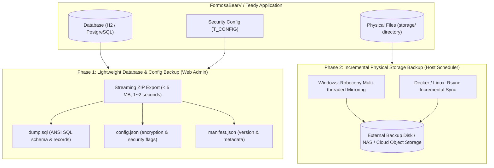
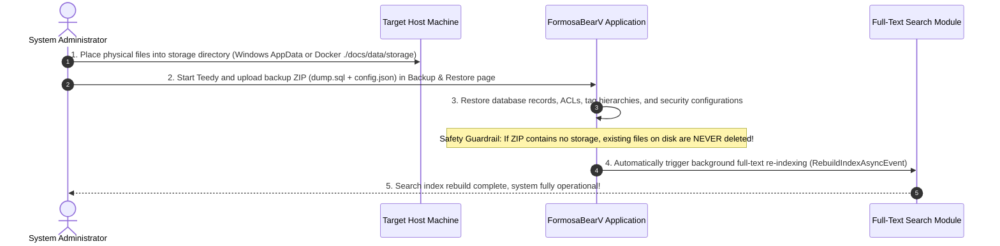

[ English ](BACKUP_GUIDE.md) | [ 繁體中文 ](BACKUP_GUIDE.zh-TW.md)

# FormosaBearV / Teedy Dual-Layer Backup & Disaster Recovery Guide

This guide explains how to perform high-speed, reliable, and uninterrupted system backup and disaster recovery operations for massive datasets (ranging from dozens of gigabytes to hundreds of gigabytes and hundreds of thousands of documents) using a **Dual-Layer Decoupled Backup Architecture**.

---

## 1. Dual-Layer Decoupled Backup Architecture

When system storage reaches 100GB or more, downloading a single consolidated ZIP over HTTP through a web browser is prone to timeouts (caused by Nginx / Cloudflare reverse proxies) or network hiccups, and standard browser downloads do not support resumable transfers.

Therefore, the system employs the industry best-practice **Dual-Layer Architecture**:



---

## 2. Physical Storage Locations

### 2.1 Docker Compose Environment (Official Recommended Deployment)
In Teedy's Docker image, the application configuration `docs.xml` sets `docs.home` to `/data`.

- **In-Container Paths**:
  - Base data directory: `/data`
  - Physical file directory: `/data/storage`
  - Trash / deleted files directory: `/data/delete`
- **Host System Corresponding Paths**:
  As defined in the root `docker-compose.yml` volume mapping:
  ```yaml
  volumes:
    - ./docs/data:/data
  ```
  The physical on-disk path on the host is:
  ```text
  <docker-compose.yml directory>/docs/data/storage
  ```

### 2.2 Windows Native Environment (Standalone Jetty / Tomcat / Windows Service)
When `-Ddocs.home` is not explicitly set in the JVM arguments, Teedy defaults to the Windows user's AppData directory:
- **Base Data Directory**:
  ```text
  %APPDATA%\FormosaBearV\Docs
  ```
- **Typical Concrete Path**:
  ```text
  C:\Users\<Username>\AppData\Roaming\FormosaBearV\Docs
  ```
- **Physical File Directory**:
  ```text
  C:\Users\<Username>\AppData\Roaming\FormosaBearV\Docs\storage
  ```
*(If `-Ddocs.home=D:\TeedyData` is configured in the startup script, the custom path takes precedence).*

### 2.3 Linux / Unix Native Environment (Non-Docker)
- **Base Data Directory**: `/var/docs`
- **Physical File Directory**: `/var/docs/storage`

---

## 3. Recommended Backup SOP

### 3.1 Step 1: Download Database & Configuration Backup via Web Admin
1. Log in to FormosaBearV / Teedy as an **Admin**.
2. Navigate to **Settings** ➔ **Backup & Restore**.
3. Click the **"Download Database & Settings Backup ZIP"** button.
4. The system streams a lightweight ZIP containing `dump.sql`, `config.json`, and `manifest.json` (typically under 5 MB), finishing within seconds.

### 3.2 Step 2: Incremental File Backup at the OS Level

#### [Windows Environment] PowerShell / CMD Command (Robocopy)
Using Windows built-in `robocopy` with multi-threading, mirroring, and automated retry on locked files (even with 100GB of files, subsequent runs only take seconds to minutes):
```powershell
# Mirror physical storage to backup drive D:\Backup\Teedy\storage
robocopy "$env:APPDATA\FormosaBearV\Docs\storage" "D:\Backup\Teedy\storage" /MIR /R:3 /W:5 /MT:8 /NP /LOG:"D:\Backup\Teedy\backup.log"
```
> **Parameters**:
> - `/MIR`: Mirror directory tree (copies only modified files and prunes deleted files at destination).
> - `/MT:8`: Uses 8 parallel threads, dramatically speeding up small file transfers.
> - `/R:3 /W:5`: Retries 3 times on locked files, waiting 5 seconds between retries.

#### [Docker / Linux Environment] Bash Command (rsync)
On the host machine, run incremental synchronization:
```bash
# Sync docs/data/storage from host Docker Compose directory to /backup/teedy/storage
rsync -avz --delete --progress ./docs/data/storage/ /backup/teedy/storage/
```
Or periodic compressed tar archive:
```bash
tar -czvf /backup/teedy/teedy_storage_$(date +%Y%m%d).tar.gz -C ./docs/data storage
```

---

## 4. Disaster Recovery SOP

When replacing the server, hardware failure occurs, or migrating between environments, follow these recovery steps:



### Detailed Recovery Steps:
1. **Restore Physical Files**:
   - **Docker**: Copy backup files into `./docs/data/storage/` on the host machine.
   - **Windows**: Copy backup files into `%APPDATA%\FormosaBearV\Docs\storage`.
2. **Start the Application**:
   - Start the Docker container or application server.
3. **Restore Database & Settings**:
   - Log in as admin, go to **Settings** ➔ **Backup & Restore**.
   - Drag and drop the lightweight backup ZIP into the restore area and click **"Start System Restore"**.
   - The system executes standard ANSI SQL statements in an atomic transaction to restore tables, ACLs, and system configurations.
4. **Safety Guardrail & Automatic Reindexing**:
   - **Built-in Guardrail**: When the uploaded backup ZIP does not contain physical files, the system **never deletes existing on-disk storage**.
   - Once the database is restored, Teedy automatically triggers `RebuildIndexAsyncEvent` in the background to reconstruct the Apache Lucene full-text search index from the on-disk files.
5. **Reload the Application**:
   - Click **"Go to Login"** or reload the browser. All documents, hierarchical tags, permissions, and search functions are immediately available.
