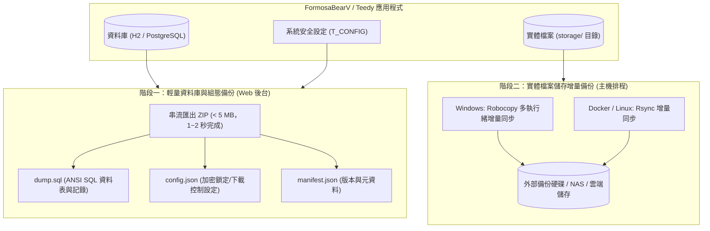
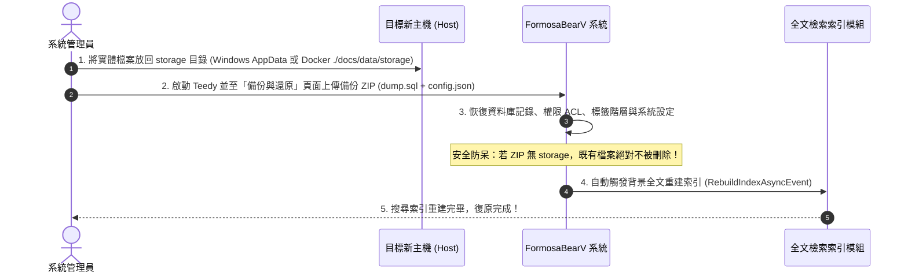

[ English ](BACKUP_GUIDE.md) | [ 繁體中文 ](BACKUP_GUIDE.zh-TW.md)

# FormosaBearV / Teedy 巨量資料備份與還原維運指南 (Backup & Disaster Recovery Guide)

本指南說明如何在海量檔案（例如數十 GB 至數百 GB、數十萬份文件）情境下，採用**「二階段分離式備份架構」**進行極速、穩定且永不逾時中斷的系統備份與災難復原作業。

---

## 1. 二階段分離式備份架構 (Dual-Layer Backup Architecture)

當系統儲存容量達 100GB 以上時，若透過瀏覽器 HTTP 下載完整打包 ZIP，極易因反向代理（Nginx / Cloudflare）請求逾時或網路抖動而中斷，且單一 HTTP 下載無法斷點續傳。

因此，系統採用業界最佳實踐（Best Practice）之**二階段分離式架構**：



---

## 2. 實體檔案目錄位置 (Physical Storage Locations)

### 2.1 Docker Compose 環境（官方推薦部署方式）
在 Teedy 的 Docker 映像檔中，系統組態 `docs.xml` 將 `docs.home` 指定為 `/data`。

- **容器內部路徑**：
  - 基礎資料目錄：`/data`
  - 實體檔案目錄：`/data/storage`
  - 回收桶目錄：`/data/delete`
- **宿主機 (Host 端) 對應路徑**：
  在專案根目錄的 `docker-compose.yml` 中的 Volume 定義為：
  ```yaml
  volumes:
    - ./docs/data:/data
  ```
  因此，宿主機上的實際儲存位置為：
  ```text
  <docker-compose.yml 所在目錄>/docs/data/storage
  ```

### 2.2 Windows 原生運行環境（獨立 Jetty / Tomcat 或本機服務）
當未在 JVM 中配置 `-Ddocs.home` 時，Teedy 預設將資料寫入當前使用者的 AppData 目錄：
- **基礎資料目錄**：
  ```text
  %APPDATA%\FormosaBearV\Docs
  ```
- **典型實際路徑**：
  ```text
  C:\Users\<Windows使用者名稱>\AppData\Roaming\FormosaBearV\Docs
  ```
- **實體檔案目錄**：
  ```text
  C:\Users\<Windows使用者名稱>\AppData\Roaming\FormosaBearV\Docs\storage
  ```
*(若有在 Tomcat / Jetty 啟動腳本設置 `-Ddocs.home=D:\TeedyData`，則以該自訂路徑為準)*

### 2.3 Linux / Unix 原生環境（非 Docker）
- **基礎資料目錄**：`/var/docs`
- **實體檔案目錄**：`/var/docs/storage`

---

## 3. 建議備份操作標準流程 (Backup SOP)

### 3.1 步驟一：由網頁後台下載資料庫與組態備份
1. 以管理員（Admin）身分登入 FormosaBearV / Teedy。
2. 進入「設置 (Settings)」➔「備份與還原 (Backup & Restore)」。
3. 點選 **「下載資料庫與設定備份 ZIP」** 按鈕。
4. 系統將即時產生包含 `dump.sql`、`config.json` 與 `manifest.json` 的輕量備份檔（通常小於 5 MB），數秒內下載完成。

### 3.2 步驟二：作業系統層級增量備份實體檔案

#### 【Windows 環境】PowerShell / CMD 指令（Robocopy）
利用 Windows 內建的 `robocopy` 支援多執行緒、增量鏡像與中斷自動重試（即使檔案達 100GB，首次複製後，日常排程僅需數秒至數分鐘）：
```powershell
# 將實體 storage 目錄鏡像同步至備份磁碟 D:\Backup\Teedy\storage
robocopy "$env:APPDATA\FormosaBearV\Docs\storage" "D:\Backup\Teedy\storage" /MIR /R:3 /W:5 /MT:8 /NP /LOG:"D:\Backup\Teedy\backup.log"
```
> **參數說明**：
> - `/MIR`：鏡像目錄（僅複製有變更的檔案，並同步刪除目標端不存在的檔案）。
> - `/MT:8`：使用 8 個執行緒平行複製，極大加快大量小檔案傳輸效率。
> - `/R:3 /W:5`：遇鎖定檔案重試 3 次，間隔 5 秒。

#### 【Docker / Linux 環境】Bash 指令（rsync）
在宿主機（Host）執行以下指令即可進行增量備份：
```bash
# 宿主機 Docker Compose 目錄下的 docs/data/storage 同步至 /backup/teedy/storage
rsync -avz --delete --progress ./docs/data/storage/ /backup/teedy/storage/
```
或定期打包封存：
```bash
tar -czvf /backup/teedy/teedy_storage_$(date +%Y%m%d).tar.gz -C ./docs/data storage
```

---

## 4. 災難復原操作標準流程 (Disaster Recovery SOP)

當伺服器損毀、更換新主機或進行主機遷移時，復原步驟如下：



### 復原步驟說明：
1. **就位實體檔案**：
   - **Docker**：將備份的檔案置於宿主機的 `./docs/data/storage/`。
   - **Windows**：將備份的檔案置於 `%APPDATA%\FormosaBearV\Docs\storage`。
2. **啟動系統**：
   - 啟動 Docker 容器或啟動應用程式服務。
3. **還原資料庫與組態**：
   - 登入管理者帳號，進入「設置」➔「備份與還原」。
   - 將先前下載的備份 ZIP（幾 MB）拖曳至還原區域，點擊「開始還原系統」。
   - 系統將套用標準 ANSI SQL 還原所有資料表，並更新系統安全設定。
4. **自動防呆與重建索引**：
   - 系統已內建防呆保護：當備份 ZIP 內無 `storage/` 檔案時，**絕對不會清空既有實體磁碟檔案**。
   - 資料庫還原成功後，Teedy 會自動觸發背景 `RebuildIndexAsyncEvent`，重新對磁碟上的所有實體檔案建立 Lucene 全文搜尋索引。
5. **重新整理頁面**：
   - 點擊「立即重新整理頁面」，所有文件、階層標籤、權限與搜尋功能即刻完全就緒。
