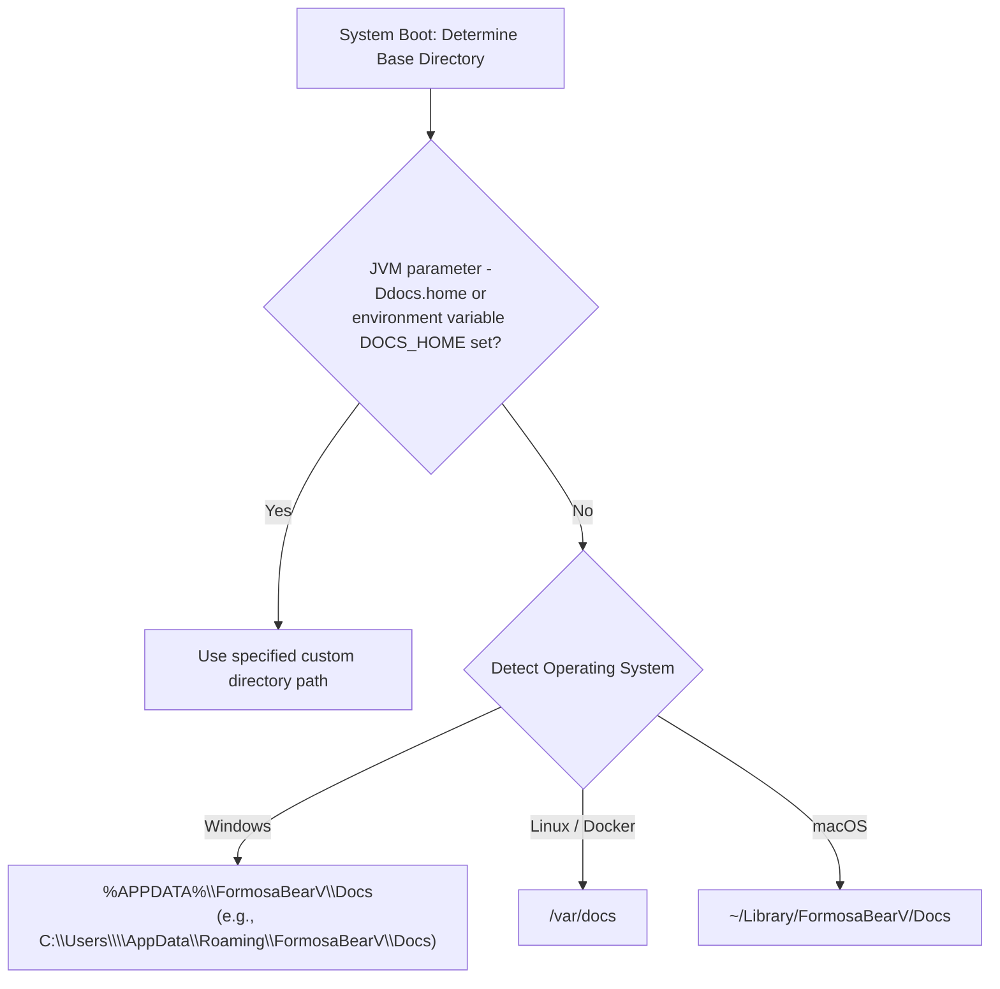
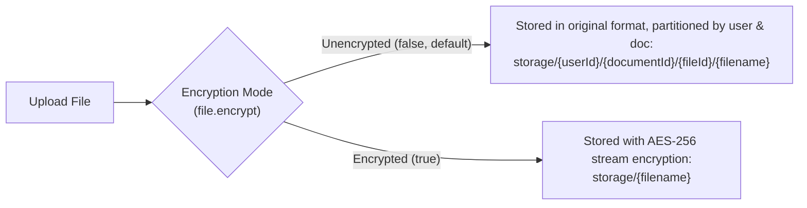
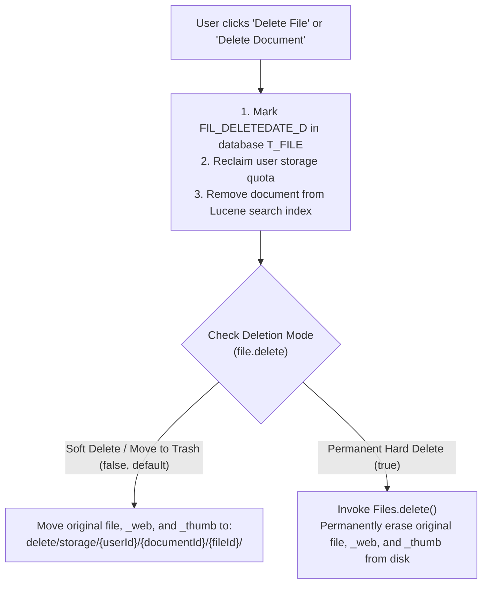

[ English ](STORAGE.md) | [ 繁體中文 ](STORAGE.zh-TW.md)

# FormosaBearV Storage Architecture & File Directory Guide

This document explains the on-disk storage locations and directory layout rules for databases, full-text indexes, logs, custom themes, and uploaded documents in **FormosaBearV (v2.02)** (corresponding to backend core classes `com.sismics.docs.core.util.DirectoryUtil` and `FileUtil`).

---

## 1. Base Data Directory

When the system starts up, it determines the **base data directory** using the following order of precedence:



### Default Base Directory by Environment

| Environment | Default Base Directory | Example Path |
| :--- | :--- | :--- |
| **Windows** | `%APPDATA%\FormosaBearV\Docs` | `C:\Users\william\AppData\Roaming\FormosaBearV\Docs` |
| **Linux / Docker** | `/var/docs` | `/var/docs` |
| **macOS** | `~/Library/FormosaBearV/Docs` | `/Users/william/Library/FormosaBearV/Docs` |
| **Custom Path (Recommended for Production)** | Set environment variable `DOCS_HOME` or JVM argument `-Ddocs.home` | e.g., `-Ddocs.home=D:\formosabearv-data` |

> [!TIP]
> Administrators can verify the actual runtime data directory at any time in **Settings -> Configuration (`#/settings/config`)**.

---

## 2. Directory Layout Under Base Directory

The system automatically manages the following subdirectories under the base data directory:

```text
<Base Data Directory>/
  ├── db/               # Embedded H2 database files (not used if external PostgreSQL is configured)
  ├── lucene/           # Apache Lucene full-text search index files
  ├── log/              # Application execution logs (docs.log)
  ├── theme/            # Custom theme images (custom logo, login page background)
  ├── storage/          # [Core] Uploaded document files, web preview renders (_web), and thumbnails (_thumb)
  └── delete/
      └── storage/      # [Trash] Stored files moved here when soft-delete mode (file.delete = false) is enabled
```

---

## 3. Upload Storage Rules (`storage/`)

Whenever a user uploads a file (e.g., `SecurityPolicy.pptx`), the system generates **3 physical files** in its dedicated directory:

1. **`SecurityPolicy.pptx`**: The original unaltered file uploaded by the user.
2. **`SecurityPolicy.pptx_web`**: Higher-resolution web preview image (width 1280px) used by the in-browser viewer.
3. **`SecurityPolicy.pptx_thumb`**: Square thumbnail image (256x256) used in document list and grid views.

### 3.1 Impact of File Encryption (`file.encrypt`)

> [!IMPORTANT]
> **`file.encrypt` is a one-time immutable system initialization setting**. Once initialized during the administrator's first setup (or after the first file is uploaded), it is permanently locked in the database and cannot be toggled, guaranteeing cryptographic consistency across all files.



- **Unencrypted Storage (`file.encrypt = false`, recommended default)**:
  - Files are stored in **native unencrypted format** on disk, allowing direct administrator backup, inspection, or disaster recovery.
  - **Associated document file path**:
    `storage/{userId}/{documentId}/{fileId}/{originalFilename}`
  - **Staged upload file path (before document creation)**:
    `storage/{userId}/{fileId}/{originalFilename}` (automatically moved into `{documentId}` once the document is created).
- **Encrypted Storage (`file.encrypt = true`)**:
  - Files are encrypted on-the-fly using the user's private key via `PBEWITHSHA256AND256BITAES-CBC-BC` (`AES/CTR/NOPADDING`). Files cannot be read directly from disk and must be accessed through the application.
  - Storage path: `storage/{originalFilename}`.

---

## 4. Deletion Policy (`file.delete`) and Duplicate Filename Policy (`file.duplicate`)

Both settings can be dynamically toggled at runtime in **Settings -> Configuration (`#/settings/config`)** without restarting the application:

### 4.1 File Deletion Policy (`file.delete`)



- **Soft Delete / Trash (`file.delete = false`, default)**:
  - The document is removed from user views and search results, and quota is refunded, but physical files are safely preserved under `delete/storage/...` to protect against accidental deletion.
- **Permanent Hard Delete (`file.delete = true`)**:
  - Along with database and index removal, physical files (`{filename}`, `{filename}_web`, `{filename}_thumb`) and parent empty folders are **permanently deleted from disk**.

### 4.2 Duplicate Filename Policy (`file.duplicate`)
- **Forbid Duplicates (`file.duplicate = false`, default)**: If a user uploads a file with an identical filename, the system rejects it and prompts that a duplicate exists (to update an existing document, use "Upload a new version" in the file context menu).
- **Allow Duplicates (`file.duplicate = true`)**: Allows identical filenames because each file is isolated in its own `{fileId}` directory on disk.

---

## 5. Backup & Disaster Recovery Guide

For large-scale deployments (100GB+) using the dual-layer decoupled backup architecture, Docker Compose / Windows host paths, and complete disaster recovery procedures, refer to:
👉 [FormosaBearV / Teedy Dual-Layer Backup & Disaster Recovery Guide (BACKUP_GUIDE.md)](BACKUP_GUIDE.md)
