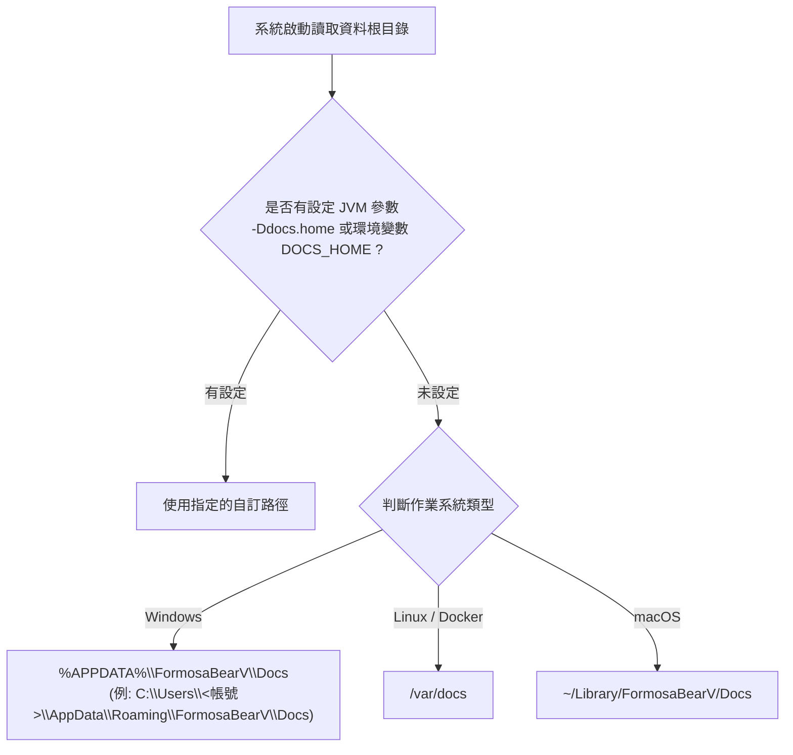
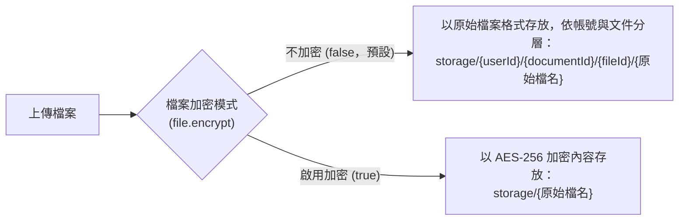
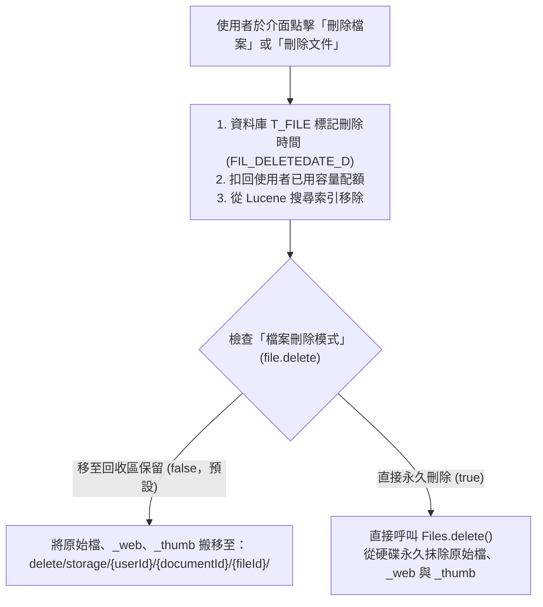

# FormosaBearV 實體檔案與資料存放路徑說明 (Storage Architecture)

本文件說明 **FormosaBearV (v2.02)** 系統中所有資料庫、全文檢索索引、日誌、自訂主題與上傳檔案在伺服器硬碟上的存放位置與目錄規則（對應後端核心類別 `com.sismics.docs.core.util.DirectoryUtil` 與 `FileUtil`）。

---

## 1. 資料根目錄 (Base Data Directory)

系統啟動時會依照以下優先順序決定 **資料根目錄**：



### 各環境預設根目錄一覽

| 執行環境 | 預設資料根目錄路徑 | 範例路徑 |
| :--- | :--- | :--- |
| **Windows** | `%APPDATA%\FormosaBearV\Docs` | `C:\Users\william\AppData\Roaming\FormosaBearV\Docs` |
| **Linux / Docker** | `/var/docs` | `/var/docs` |
| **macOS** | `~/Library/FormosaBearV/Docs` | `/Users/william/Library/FormosaBearV/Docs` |
| **自訂路徑（推薦生產環境使用）** | 設定環境變數 `DOCS_HOME` 或 JVM 參數 `-Ddocs.home` | 例如 `-Ddocs.home=D:\formosabearv-data` |

> [!TIP]
> 管理員登入系統後，可直接前往 **「設置 -> 設定 (`#/settings/config`)」** 查看伺服器當前的實際資料存放根目錄路徑。

---

## 2. 根目錄下的子目錄結構

在資料根目錄下，系統會自動建立並維護以下子目錄：

```text
<資料根目錄>/
  ├── db/               # 嵌入式 H2 資料庫實體檔案（若使用外部 PostgreSQL 則不使用此目錄）
  ├── lucene/           # Apache Lucene 全文檢索索引檔
  ├── log/              # 系統執行日誌檔案 (docs.log)
  ├── theme/            # 系統自訂主題圖片（Logo、登入頁背景圖）
  ├── storage/          # 【核心】所有上傳的正式檔案、預覽圖 (_web) 與縮圖 (_thumb)
  └── delete/
      └── storage/      # 【回收區】當「檔案刪除模式 (file.delete)」設為「移至回收區」時，被刪除的檔案存放處
```

---

## 3. 上傳檔案 (`storage/`) 的存放規則

每當使用者上傳一個檔案（例如 `資安規範.pptx`），系統會在該檔案專屬的目錄下產生 **3 個實體檔案**：

1. **`資安規範.pptx`**：使用者上傳的原始檔案本體。
2. **`資安規範.pptx_web`**：系統轉檔產生的較高解析度預覽圖（寬度 1280px，供網頁預覽視窗使用）。
3. **`資安規範.pptx_thumb`**：系統轉檔產生的正方形縮圖（256x256，供列表與卡片縮圖使用）。

### 3.1 檔案加密模式 (`file.encrypt`) 對存放結構的影響

> [!IMPORTANT]
> **`file.encrypt` 屬於系統初始化一次性認定設定**。一旦管理員於首次登入時完成認定（或系統已上傳第一個檔案），該設定即永久鎖定於資料庫中，不可再變更，以確保系統內所有檔案的加密/解密狀態一致。



- **不加密儲存（`file.encrypt = false`，預設推薦）**：
  - 檔案以**原始未加密格式**直接存放在磁碟上，方便系統管理員直接於作業系統層級進行備份、檢視或救援。
  - **已歸屬文件之檔案路徑**：
    `storage/{使用者ID}/{文件ID}/{檔案ID}/{原始檔名}`
  - **快速上傳區（尚未建立文件）之暫存檔案路徑**：
    `storage/{使用者ID}/{檔案ID}/{原始檔名}`（當使用者勾選並建立文件後，系統會自動將其搬移至 `{文件ID}` 目錄下）。
- **啟用加密儲存（`file.encrypt = true`）**：
  - 檔案在寫入磁碟時，會使用該使用者的私鑰透過 `PBEWITHSHA256AND256BITAES-CBC-BC` (`AES/CTR/NOPADDING`) 進行串流加密，直接從磁碟打開無法閱讀，必須透過系統應用程式解密讀取。
  - 存放路徑：`storage/{原始檔名}`。

---

## 4. 檔案刪除模式 (`file.delete`) 與重複檔名設定 (`file.duplicate`)

這兩項設定可由管理員隨時於 **「設置 -> 設定 (`#/settings/config`)」** 動態切換，無須重啟伺服器即可生效：

### 4.1 檔案刪除模式 (`file.delete`)



- **移至回收區保留（`file.delete = false`，預設）**：
  - 前台介面與搜尋結果立即移除該檔案，並釋放使用者的配額空間，但硬碟上的實體檔案會被搬移至 `delete/storage/...` 目錄下妥善保留，防止誤刪。
- **直接從磁碟永久刪除（`file.delete = true`）**：
  - 除了從前台與搜尋索引移除外，會直接將硬碟上的 `{原始檔名}`、`{原始檔名}_web`、`{原始檔名}_thumb` 及空目錄**徹底從硬碟刪除**，不保留於 `delete/storage/`。

### 4.2 重複檔案名稱檢查 (`file.duplicate`)
- **禁止重複檔名（`file.duplicate = false`，預設）**：同一位使用者上傳相同檔名的新檔案時，系統會攔截並提示「已經有相同檔案名稱」（避免重複上傳相同檔案；若要更新舊檔可使用檔案選單中的「上傳新的版本」）。
- **允許重複檔名（`file.duplicate = true`）**：允許上傳相同檔案名稱（因為每個檔案在磁碟上都有獨立的 `{檔案ID}` 子資料夾，因此同檔名在未加密分層目錄下也不會互相覆蓋）。
