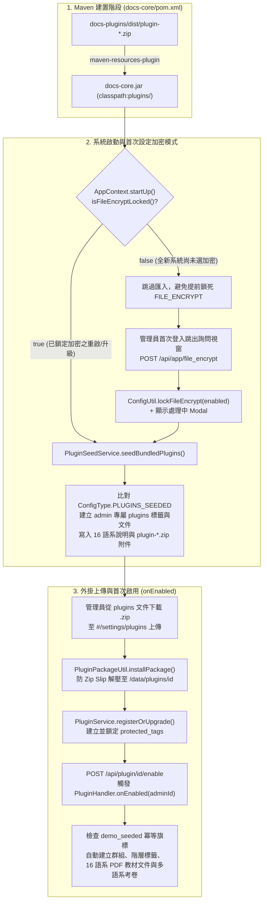
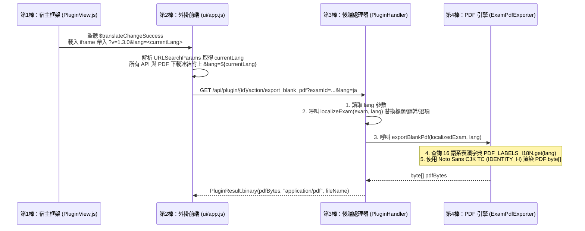

# FormosaBearV Docs — AI 外掛開發鐵律與實戰聖經 (`docs-plugins/AGENTS.md`)

> **給 AI 代理 (AI Agents) 的首要指令**：
> 當人類工程師要求你在 `FormosaBearV-Docs` 新增、修改、除錯或打包任何外掛（Plugin）時，**你必須在動手前完整讀完本檔案 (`docs-plugins/AGENTS.md`)**，並依需求參考同目錄下的：
> - 通用外掛平台規格：[PLUGIN_GUIDE.zh-TW.md](PLUGIN_GUIDE.zh-TW.md) / [PLUGIN_GUIDE.md](PLUGIN_GUIDE.md)
> - 官方全端示範外掛 (`online-exam`) 完整實作拆解：[online-exam/README.zh-TW.md](online-exam/README.zh-TW.md) / [online-exam/README.md](online-exam/README.md)

---

## 1. 全域檔案導航地圖 (Exact Touchpoints Map)

開發或修改一個「全端外掛（前端 `.zip` + 後端 `PluginHandler`）」時，涉及的所有精確檔案路徑如下：

| 層級 | 檔案路徑 | 核心職責與修改時機 |
| --- | --- | --- |
| **外掛前端與資源包** | `docs-plugins/<plugin-id>/plugin.json` | 外掛唯一識別碼 (`id`)、版號 (`version`)、16 語系導覽列 (`nav_label_i18n`)、後端處理器名稱 (`handler`)、保護標籤 (`protected_tags`)。**必須位於 `.zip` 根目錄**。 |
| **外掛多語系字典** | `docs-plugins/<plugin-id>/locale/*.json` | 16 國語系翻譯檔（`en`, `zh_TW`, `zh_CN`, `ja`, `vi`, `de`, `fr`, `es`, `pt`, `pt_BR`, `it`, `pl`, `ru`, `el`, `sq_AL`, `sr`），含 `error.<Type>` 後端錯誤碼對映。 |
| **外掛前端 UI** | `docs-plugins/<plugin-id>/ui/{index.html,app.js,style.css}` | 執行於宿主 `#/plugin/<id>` `iframe` 容器內的零外部 CDN 依賴前端程式。 |
| **外掛內建種子檔** | `docs-plugins/<plugin-id>/seed/*` | 隨 `.zip` 解壓至 `/data/plugins/<id>/seed/` 的題庫、多語系字典或初始資源檔。 |
| **外掛發布成品** | `docs-plugins/dist/plugin-<plugin-id>.zip` | 編譯時由 `docs-core/pom.xml` (`maven-resources-plugin`) 自動複製進 `classpath:plugins/`，隨 WAR / Docker / Portable 出貨。 |
| **SPI 介面定義** | `docs-core/src/main/java/com/sismics/docs/core/util/plugin/PluginHandler.java` | 定義 `getId()`、`handleAction(...)`、`findTagReferenceReason(tagId)`、`onEnabled(installerUserId)` 四大方法。 |
| **SPI 註冊與生命週期** | `docs-core/src/main/java/com/sismics/docs/core/util/plugin/PluginService.java` | **新增 `PluginHandler` 實作類別時，必須在 `PluginService` 的 `static {}` 區塊呼叫 `registerHandler(new MyPluginHandler())`！** |
| **套件解壓與安全驗證** | `docs-core/src/main/java/com/sismics/docs/core/util/plugin/PluginPackageUtil.java` | 負責上傳 `.zip` 的 Zip Slip 路徑檢查、解壓至 `/data/plugins/<id>/`，以及提供 `resolvePluginAsset(pluginId, relativePath)` 安全讀取內部檔案。 |
| **內建外掛自動植入** | `docs-core/src/main/java/com/sismics/docs/core/util/plugin/PluginSeedService.java` | 將 `classpath:plugins/plugin-*.zip` 植入管理員專屬 `plugins` 文件（受 `ConfigType.PLUGINS_SEEDED` 與 `ConfigUtil.isFileEncryptLocked()` 管控）。 |
| **REST 端點控制器** | `docs-web/src/main/java/com/sismics/docs/rest/resource/PluginResource.java` | 提供 `/api/plugin/*`（上傳、啟用/停用、靜態資源讀取、通用 `data` CRUD、以及轉發 `/api/plugin/{id}/action/{action}`）。 |

---

## 2. 系統整體外掛生命週期流程圖 (Mermaid Architecture)



---

## 3. AI 開發外掛 10 大必守鐵律（`❌ 踩雷寫法` vs `✅ 正確寫法`）

### 鐵律 1：程式建立檔案（如 PDF 教材或 `.zip`）時，嚴禁使用 `Files.createTempFile` 並在 `finally` 刪除！
- **原因**：`FileUtil.createFile(...)` 會發出 `FileCreatedAsyncEvent`，交由背景執行緒 `FileProcessingAsyncListener` **在交易 commit 之後非同步讀取 `unencryptedFile`**，進行 **(1) 產生縮圖、(2) PDFBox 抽取純文字存入 `file.setContent(...)`（供前端「眼睛」圖示 `/api/file/{id}/data?size=content` 檢視純文字）、(3) 寫入 Lucene 全文檢索索引**。若在 `finally` 立即刪除暫存檔，背景執行緒讀不到檔案，會導致按下「眼睛」一片空白且搜尋不到內容！

```java
// ❌ FORBIDDEN（錯誤：背景 FileProcessingAsyncListener 還沒讀到檔案就被 finally 刪掉了！）
Path tempPdf = Files.createTempFile("my-doc-", ".pdf");
try {
    Files.write(tempPdf, pdfBytes);
    FileUtil.createFile(fileName, null, tempPdf, pdfBytes.length, "eng", actorId, docId);
} finally {
    Files.deleteIfExists(tempPdf); // ❌ 絕對禁止！會導致無純文字、無縮圖、無搜尋索引！
}

// ✅ REQUIRED（正確：交由 FileService 建立並管理暫存檔生命週期）
Path tempPdf = AppContext.getInstance().getFileService().createTemporaryFile(fileName);
Files.write(tempPdf, pdfBytes);
FileUtil.createFile(fileName, null, tempPdf, pdfBytes.length, "eng", actorId, docId);
```

---

### 鐵律 2：系統啟動時匯入檔案，必須檢查 `ConfigUtil.isFileEncryptLocked()`（且必須在 `TransactionUtil.handle` 內檢查）！
- **原因**：
  1. `FileUtil.createFile(...)` 內部會呼叫 `ConfigUtil.ensureFileEncryptLocked()`，一旦在全新系統尚未設定前寫入任何檔案，就會把系統永久鎖死在預設未加密模式！
  2. `ConfigUtil.isFileEncryptLocked()` 內部第一行是 `if (!hasActiveEntityManager()) return true;`——若在 `TransactionUtil.handle(...)` **外部**呼叫，因為沒有 `EntityManager` 會誤判為 `true`！

```java
// ❌ FORBIDDEN（錯誤：在 TransactionUtil.handle 外呼叫 isFileEncryptLocked() 永遠回傳 true！）
if (ConfigUtil.isFileEncryptLocked()) {
    TransactionUtil.handle(() -> { ... });
}

// ✅ REQUIRED（正確：在 TransactionUtil.handle 內部檢查，且於 AppResource.fileEncrypt 鎖定後立即補觸發）
TransactionUtil.handle(() -> {
    if (!ConfigUtil.isFileEncryptLocked()) {
        return; // 等管理員於 POST /api/app/file_encrypt 選定加密模式後再匯入
    }
    // 執行檔案匯入...
});
```

---

### 鐵律 3：寫入 `T_ACL` 權限時，無論對象是「帳號 (User)」或「群組 (Group)」，`Acl.setType(...)` 一律設為 `AclType.USER`！
- **原因**：主系統 `AclResource.java` 與 `AclDao.java` 的底層設計中，`AclType.USER` 代表「手動指派的權限（相對於 Routing 工作流產生的權限）」，其 `targetId` 可為 `userId` 或 `groupId`。此外，呼叫 REST `PUT /api/acl` 時，表單參數名稱是 `target`（填 username 或 groupName），**不是** `username`！

```java
// ✅ REQUIRED：無論 targetId 是 userId 還是 groupId，AclType 一律填 AclType.USER
AclDao aclDao = new AclDao();
if (!aclDao.hasDirectAcl(sourceId, perm, targetId, AclType.USER)) {
    Acl acl = new Acl();
    acl.setSourceId(sourceId);
    acl.setTargetId(targetId); // 可為 user.getId() 或 group.getId()
    acl.setPerm(perm);         // PermType.READ 或 PermType.WRITE
    acl.setType(AclType.USER); // 固定為 AclType.USER
    aclDao.create(acl, actorId);
}
```

---

### 鐵律 4：程式直接呼叫 `DocumentDao.create` 建立文件時，必須補發 `DocumentCreatedAsyncEvent`，且 `description` 欄位必須使用 HTML 標籤（`<ul><li>` / `<p>` / `<br>`）排版！
- **原因**：
  1. `DocumentDao.create(doc, userId)` 只寫入資料庫 `T_DOCUMENT`，不會自動通知 Lucene 建立文件標題與說明的索引。必須手動加入 `DocumentCreatedAsyncEvent` 至 `ThreadLocalContext`。
  2. 主系統前端 `document.view.content.html` 是以 `<p class="well-sm" ng-bind-html="document.description"></p>` 渲染文件說明（編輯器亦為 HTML 富文本）。若在 `doc.setDescription(...)` 只用純文字 `\n` 換行，在瀏覽器中會全部折疊成空白擠在同一行！務必使用語意化 HTML（如 `<ul><li><strong>[zh_TW]</strong> ...</li></ul>`、`<p>`、`<br>`），且不要使用 inline `style="..."`（會被 AngularJS `$sanitize` 過濾）。

```java
// ✅ REQUIRED：建立文件後綁定 ACL、標籤並觸發非同步索引事件
String docId = new DocumentDao().create(doc, actorId);
grantTargetAclIfAbsent(docId, actorId, PermType.READ, actorId);
grantTargetAclIfAbsent(docId, actorId, PermType.WRITE, actorId);
new TagDao().updateTagList(docId, Set.of(tagId));

DocumentCreatedAsyncEvent event = new DocumentCreatedAsyncEvent();
event.setUserId(actorId);
event.setDocumentId(docId);
ThreadLocalContext.get().addAsyncEvent(event);
```

---

### 鐵律 5：自動建立標籤 (`Tag`) 時，名稱嚴禁包含「空白」或「冒號」；自動建立群組 (`Group`) 時，`roleId` 必須為 `null`！
- **原因**：
  1. 主系統 `ValidationUtil.validateTagName(name)` 禁止標籤含空白或 `:`（為了讓搜尋語法 `tag:TagName` 正常運作）。請使用駝峰式英文名，例如 `OnlineExamMaterials`、`SecurityFundamentals`。（唯一例外是 `plugin.json` 的隱藏系統標籤 `protected_tags` 由 `PluginService` 直接寫入且設為 `hidden: true`）。
  2. **資安防線（禁止權限提升）**：外掛透過 `GroupDao.create` 自動建立展示或功能群組時，`group.setRoleId(null)` 必須為 `null`，嚴禁綁定 `admin` 角色；且若同名群組或標籤已存在，**只可沿用其 ID，嚴禁覆蓋或竄改既有群組／標籤的 ACL**。

---

### 鐵律 6：外掛綁定主系統「參考文件」時，必須採用「嚴格權限模式 (Strict Mode)」並從 iframe 正確計算主站路由！
- **後端檢查**：
  1. 綁定時驗證操作者對該 `docId` 具備 `PermType.READ`：`new AclDao().checkPermission(docId, PermType.READ, ctx.getTargetIdList())`（此方法同時支援直接 ACL 與標籤繼承 ACL）。
  2. 回傳給考生／一般使用者時，必須用**當前觀看者的 `ctx.getTargetIdList()`** 逐筆過濾 `reference_document_ids`，無權限或已刪除者直接略過不回傳，**絕不洩漏無權限文件的標題或 ID**。
  3. 注意：主站 `GET /api/document/{id}` 對無 `READ` 權限者會回傳 HTTP **`404`**（而非 `403`）。
- **前端 iframe 開啟主站文件 URL 計算**：
  外掛 UI 位於 `<contextPath>/api/plugin/<id>/assets/ui/index.html`，開啟主站文件的正確路由是 `#/document/view/<docId>`（**不是** `#/document/<docId>`）：

```javascript
// ✅ REQUIRED：支援任意 Context Path 的主站文件檢視連結
const appRootMatch = window.location.pathname.match(/^(.*)\/api\/plugin\/[^/]+\/assets\//);
const APP_ROOT = appRootMatch ? (appRootMatch[1] || '') : '';
function buildDocumentViewUrl(docId) {
  return `${APP_ROOT}/#/document/view/${encodeURIComponent(docId)}`;
}
```

---

### 鐵律 7：OpenPDF 產製 16 國語系 PDF（確保「眼睛」抽字與全文檢索 100% 正常）
- **原因**：使用預設 Helvetica 字型無法渲染中日韓、越文、西里爾（俄文／塞爾維亞文）與希臘文，且會導致抽出的純文字缺字。必須使用宿主已註冊的 `PdfUtil.BUNDLED_CJK_FONT_FAMILY` (`"Noto Sans CJK TC"`) 搭配 `BaseFont.IDENTITY_H`：

```java
// ✅ REQUIRED：支援全 16 語系渲染並內嵌 ToUnicode CMap 供 PDFBox 抽字
IFontProvider fontProvider = PdfUtil.getFontProvider();
Font titleFont = fontProvider.getFont(
    PdfUtil.BUNDLED_CJK_FONT_FAMILY, BaseFont.IDENTITY_H, 16f, Font.BOLD, new Color(25, 35, 55));
Font bodyFont = fontProvider.getFont(
    PdfUtil.BUNDLED_CJK_FONT_FAMILY, BaseFont.IDENTITY_H, 10.5f, Font.NORMAL, new Color(30, 41, 59));
```

---

### 鐵律 8：從 Classpath JAR 掃描資源時，務必設定 `JarURLConnection.setUseCaches(false)`！
- **原因**：在 `PluginSeedService` 等處使用 `JarURLConnection.getJarFile()` 時，Java 預設回傳與 ClassLoader 共用的快取 `JarFile`。若直接放進 `try (JarFile jar = conn.getJarFile())` 自動關閉，會把整個 Web App ClassLoader 的 JAR 關掉並拋出 `IllegalStateException: zip file closed`！

```java
// ✅ REQUIRED：先關閉快取再開啟 JarFile
JarURLConnection conn = (JarURLConnection) url.openConnection();
conn.setUseCaches(false);
try (JarFile jarFile = conn.getJarFile()) {
    // 安全遍歷條目...
}
```

---

### 鐵律 9：單一資料實體內建 16 國語系動態切換 (`localizeExam`) ＋ 四棒接力動態產製多語系 PDF 報表
- 當外掛在 `onEnabled` 自動建立預設示範資料（如 `SEC-001` 考卷）時，不要建立 16 筆重複考卷塞爆列表！
- **正確做法**：只建立 1 筆考卷（固定題號 `q1..q4` 與選項 ID `c1..c4`），將 16 國翻譯存於 `seed/SEC-001-i18n.json` 並掛入考卷 JSON 的 `"i18n"` 欄位。
- **為什麼切換語系後，連下載的考卷 PDF（空白卷、作答卷、成績彙總表）也會自動變成該國語系？**
  這是「宿主框架 ＋ 外掛前後端」的 **四棒接力架構**（未來 AI 為任何外掛開發多語系 PDF 匯出時，請 100% 照抄此模式）：



```java
// ✅ REQUIRED：後端 Action 接收 lang 參數、動態本地化資料並回傳二進位 PDF 串流範本
private PluginResult handleExportBlankPdf(PluginContext ctx) throws Exception {
    String examId = ctx.getQueryParams().getOrDefault("examId", "").trim();
    String lang = ctx.getQueryParams().getOrDefault("lang", "en").trim();
    JsonObject exam = loadExam(examId);
    if (exam == null) {
        return error(404, "ExamNotFound", "Exam not found");
    }
    if (!canManageExam(ctx, exam) && !canTakeExam(ctx, exam)) {
        return error(403, "ForbiddenError", "No permission for this exam");
    }
    // 先依 lang 替換多語系內容，再剝除機密正解，最後交由 OpenPDF 以 Noto Sans CJK TC 渲染該語系表頭與內文
    byte[] pdfBytes = ExamPdfExporter.exportBlankPdf(stripAnswersFromExam(localizeExam(exam, lang)), lang);
    String fileName = sanitizeFileName(exam.getString("exam_code", "exam") + "_v" + exam.getString("exam_version", "1")) + "_blank.pdf";
    return PluginResult.binary(pdfBytes, "application/pdf", fileName);
}
```

---

### 鐵律 10：標準打包與整合測試指令 (Copy-Paste Commands)

每次修改 `docs-plugins/<id>/` 或 `docs-core` 後，AI 必須依序執行以下指令完成打包與驗證：

```powershell
# 1. 設定 JDK 21 環境變數
$env:JAVA_HOME='W:\developer\jdk-21'; $env:Path="$env:JAVA_HOME\bin;$env:Path"

# 2. 將 docs-plugins/online-exam 打包為 docs-plugins/dist/plugin-online-exam.zip（確保 plugin.json 在根目錄且路徑為 POSIX /）
python -c "import pathlib, zipfile; src=pathlib.Path('docs-plugins/online-exam'); zf=zipfile.ZipFile('docs-plugins/dist/plugin-online-exam.zip','w',zipfile.ZIP_DEFLATED); [zf.write(p, p.relative_to(src).as_posix()) for p in sorted(src.rglob('*')) if p.is_file()]; zf.close()"

# 3. 編譯並安裝 docs-core（會自動把 plugin-*.zip 複製進 docs-core JAR 的 plugins/ 目錄）
mvn install -pl ".,docs-core,docs-web-common" -DskipTests -q -o

# 4. 執行外掛與標籤整合測試
mvn test -pl docs-web -Dtest="TestTagResource,TestPluginResource,TestOnlineExamPlugin" -o

# 5. 打包最終 WAR 檔（產出 docs-web/target/docs-web-3.01-SNAPSHOT.war）
mvn package -pl docs-web -DskipTests -q -o
```
