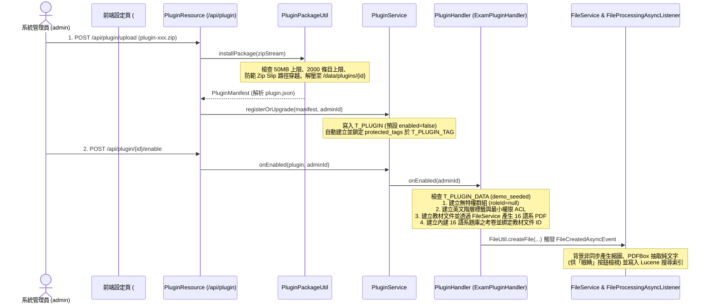

# FormosaBearV Docs 外掛開發指南 (`3.01-SNAPSHOT`)

> **AI 代理必讀提示**：若您是負責開發或維護外掛的 AI Agent，請務必同時閱讀 [docs-plugins/AGENTS.md](AGENTS.md)（收錄 10 大避坑鐵律與對照程式碼）以及 [online-exam/README.zh-TW.md](online-exam/README.zh-TW.md)（官方全端外掛完整拆解）。

本指南說明如何為 **FormosaBearV Docs**（`3.01-SNAPSHOT` 以上）開發、多語系化、打包、自動植入與安全部署第三方外掛套件。

---

## 1. 架構總覽與整合模式

FormosaBearV Docs 提供兩種外掛整合模式：

1. **純前端外掛 + 通用 JSON 資料儲存 (`T_PLUGIN_DATA`)**：
   - 上傳包含 `plugin.json`、靜態 HTML/CSS/JS 與 `locale/*.json` 的 `.zip` 壓縮檔。
   - 宿主透過獨立路由 `#/plugin/<id>` 的 `iframe` 容器載入畫面。
   - 直接呼叫 `/api/plugin/{id}/data/{collection}/{key}` 讀寫資料，並內建非管理員機密欄位自動遮罩。
2. **全端擴充外掛 (`PluginHandler` SPI)**：
   - 前端 `.zip` 套件搭配註冊於 `PluginService` 的 Java `PluginHandler`。
   - 支援四大生命週期與擴充掛鉤：
     - `getId()`：對應 `plugin.json` 的 `"handler"`。
     - `handleAction(method, action, context)`：處理 `/api/plugin/{id}/action/{action}` 自訂商業邏輯（如後端批改、權限隔離、PDF 二進位串流匯出）。
     - `findTagReferenceReason(tagId)`：防止外掛正在使用的標籤被誤刪。
     - `onEnabled(installerUserId)`：首次啟用外掛時自動建置展示／預設群組、階層標籤、多語系教材文件與初始資料。

---

## 2. 外掛安裝、首次啟用與執行期序列圖 (Mermaid Sequence Diagram)



---

## 3. 套件目錄結構與打包規範

```text
my-plugin/
├── plugin.json          # 必須位於 ZIP 根目錄
├── locale/              # 標準 16 國語系 JSON 目錄
│   ├── en.json          # 必備預設 / Fallback 語系
│   └── zh_TW.json       # 對應主系統語系代碼的翻譯檔
├── seed/                # (選填) 首次啟用時供 PluginHandler.onEnabled 讀取的種子資料
│   ├── SEC-001.gift
│   └── SEC-001-i18n.json
└── ui/
    ├── index.html       # 對應 plugin.json 的 "entry" 路徑
    ├── style.css
    └── app.js
```

### 打包與隨系統出貨規範 (`docs-plugins/dist/plugin-*.zip`)
- `plugin.json` **必須位於 `.zip` 根目錄**（不可多包一層父資料夾），且壓縮條目路徑分隔符必須為 POSIX `/`（不可為 Windows `\`）。
- 命名規範：所有放置於 `docs-plugins/dist/plugin-*.zip` 的壓縮包，在執行 `mvn process-resources` / `mvn package` 時，會由 `docs-core/pom.xml` 的 `maven-resources-plugin` 自動複製進 `docs-core` JAR 的 `plugins/` 目錄。
- **自動植入 `plugins` 文件機制 (`PluginSeedService`)**：
  - 系統首次安裝時，會等待管理員於首次登入彈窗（或設定頁）呼叫 `POST /api/app/file_encrypt` 選定「加密儲存」或「不加密儲存」後，立即將 `classpath:plugins/plugin-*.zip` 匯入管理員專屬的 `plugins` 文件（綁定一般顯示但僅 `admin` 有權限的 `plugins` 標籤），並在文件「說明（Description）」欄位寫入 16 語系安裝說明與各 `.zip` 用途。
  - 已匯入過的檔名會記錄於 `T_CONFIG` 的 `PLUGINS_SEEDED`；未來系統升級若新增其他 `plugin-yyy.zip`，啟動時會自動比對並補入 `plugins` 文件。

---

## 4. `plugin.json` 完整欄位規範

```json
{
  "id": "online-exam",
  "name": "Online Exam",
  "version": "1.3.0",
  "default_locale": "en",
  "description": "Moodle GIFT online exam system with tag-based access control, backend grading, and watermarked PDF export.",
  "entry": "ui/index.html",
  "nav_label": "Online Exam",
  "nav_label_i18n": {
    "en": "Online Exam",
    "zh_TW": "線上考試"
  },
  "nav_icon": "fas fa-graduation-cap",
  "handler": "online-exam",
  "protected_tags": [
    {
      "role": "MANAGEMENT",
      "name": "Online Exam Admin",
      "color": "#8b5cf6",
      "hidden": true,
      "description": "Exam managers (teachers)"
    }
  ]
}
```

| 欄位 | 必填 | 說明 |
| --- | --- | --- |
| `id` | 是 | 小寫英數字與連字號（`^[a-z0-9][a-z0-9-]{0,62}$`）。 |
| `name` | 是 | 外掛管理頁顯示名稱。 |
| `version` | 是 | 版號字串（顯示於管理介面並用於靜態資源快取控制）。 |
| `entry` | 否 | 外掛前端進入點相對路徑（預設 `index.html`）。 |
| `nav_label` | 否 | 頂部導覽列預設顯示名稱。 |
| `nav_label_i18n` | 否 | 依 16 語系代碼對應導覽列名稱的物件，隨系統切換語系即時變換。 |
| `nav_icon` | 否 | FontAwesome 圖示類別（例如 `fas fa-graduation-cap`）。 |
| `default_locale` | 否 | 預設語系代碼（預設 `en`）。 |
| `handler` | 否 | 對應 `PluginService` 註冊之 `PluginHandler` ID。 |
| `protected_tags` | 否 | 安裝時自動建立並鎖定於 `T_PLUGIN_TAG` 的保護標籤清單（支援 `role`、`name`、`color`、`hidden` 與選填單行 `description`，上限 200 字；升級時若管理員已自訂說明不會被覆蓋，且管理員仍可於 `#/tagadmin/{id}` 修改說明與顏色）。 |

---

## 5. 進階後端擴充 (`PluginHandler` SPI) 與資安五防線

實作 `com.sismics.docs.core.util.plugin.PluginHandler` 並於 `PluginService` 註冊：

```java
public interface PluginHandler {
    String getId();
    PluginResult handleAction(String method, String action, PluginContext context) throws Exception;
    default Optional<String> findTagReferenceReason(String tagId) {
        return Optional.empty();
    }
    default void onEnabled(String installerUserId) throws Exception {
    }
}
```

### 外掛自動建置系統資源 (`onEnabled`) 的 5 道資通安全防線
當外掛於 `onEnabled(installerUserId)` 自動建立群組、階層標籤、文件與檔案時，必須遵守：
1. **禁止權限提升 (No Privilege Escalation)**：新建 `Group` 時 `setRoleId(null)` 必須為 `null`，嚴禁賦予 `ADMIN` 角色；若同名群組或標籤已存在，僅可沿用其 ID，不得修改既有群組或標籤的 ACL。
2. **預設最小權限 (Least Privilege)**：自動建立的標籤與文件僅授權 `installerUserId` (`admin`) 及外掛專屬群組（如教師群組讀寫、學生群組唯讀），不對全系統所有帳號公開。
3. **檔案安全與大小上限**：從外掛套件讀取種子檔案必須透過 `PluginPackageUtil.resolvePluginAsset(pluginId, relativePath)`（防範路徑穿越）並檢查檔案大小上限；寫入文件附件必須透過 `AppContext.getInstance().getFileService().createTemporaryFile(fileName)` 與 `FileUtil.createFile(...)` 以遵守系統加密設定、硬碟配額與背景純文字抽取／Lucene 索引流程。
4. **標籤命名合規**：自動建立的一般顯示標籤（`hidden = false`）應使用不含空白與冒號的英文名稱（如 `OnlineExamMaterials` -> `SecurityFundamentals`），以符合 `ValidationUtil.validateTagName` 並支援 `tag:` 語法搜尋。
5. **冪等執行 (Idempotency)**：於 `T_PLUGIN_DATA` 記錄初始化旗標（如 `demo_seeded = "true"`），確保停用後再啟用或版本升級時不會重複建立資料。

---

## 6. 隨系統語系即時切換之多語系 PDF 報表匯出架構（四棒接力模式）

FormosaBearV Docs 外掛平台支援「當使用者於主系統切換任一語系（共 16 國語系）時，外掛內預覽與下載的 PDF 報表自動切換為該國語系」。未來 AI 開發新外掛的 PDF 匯出功能時，請遵循以下四棒接力架構：

1. **第一棒（宿主框架 `PluginView.js` 自動注入 `?lang=`）**：
   宿主載入外掛 `iframe` 時會自動帶入 `?v=<version>&lang=<currentLang>`，並在主系統切換語系時自動刷新 `iframe`。
2. **第二棒（外掛前端 `ui/app.js` 傳遞 `&lang=`）**：
   前端透過 `new URLSearchParams(window.location.search).get('lang')` 取得 `currentLang`，並在所有 API 查詢與 PDF 匯出超連結帶入 `&lang=${encodeURIComponent(currentLang)}`。
3. **第三棒（後端 `PluginHandler` 動態本地化資料 `localizeExam(data, lang)`）**：
   後端 Action 由 `ctx.getQueryParams().getOrDefault("lang", "en")` 取得語系代碼，若資料含 `"i18n"` 多語系字典，即時替換標題與內文欄位。
4. **第四棒（OpenPDF + `PdfUtil.BUNDLED_CJK_FONT_FAMILY` + 16 語系表頭字典 + `PluginResult.binary`）**：
   PDF 產製器內建 16 語系表頭字典（`PDF_LABELS_I18N`），並使用 `PdfUtil.getFontProvider().getFont(PdfUtil.BUNDLED_CJK_FONT_FAMILY, BaseFont.IDENTITY_H, ...)`（`Noto Sans CJK TC`）渲染文字，最後以 `PluginResult.binary(pdfBytes, "application/pdf", fileName)` 直接串流回傳下載。

