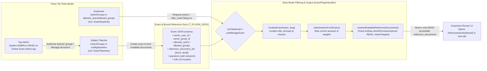
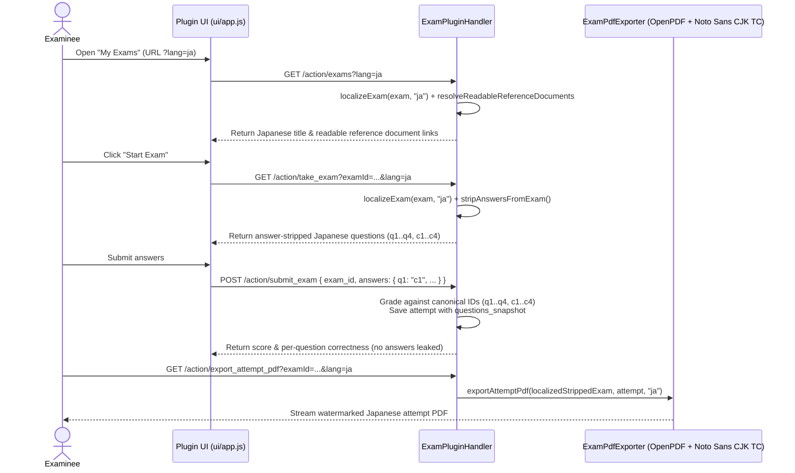

# Online Exam Plugin (`online-exam`) — Architecture, Design Journey & AI Blueprint

> **Mandatory Reading for AI Agents**: This document details the complete design journey, file-by-file responsibilities, API contracts, and security patterns of the `online-exam` showcase plugin. Before modifying any plugin code, always read [../AGENTS.md](../AGENTS.md) and [../PLUGIN_GUIDE.md](../PLUGIN_GUIDE.md).

---

## 1. Design Journey & Key Engineering Decisions

While building `online-exam`, we solved six critical architectural and security challenges that serve as the standard blueprint for future AI-developed plugins:

1. **Bundling `plugin-*.zip` for Docker / Portable / WAR Without Prematurely Locking File Encryption**:
   - `docs-plugins/dist/plugin-online-exam.zip` is copied into `docs-core`'s `classpath:plugins/` via `maven-resources-plugin`.
   - **Critical Gotcha**: Calling `FileUtil.createFile(...)` during initial startup (`AppContext.startUp()`) before the administrator chooses whether to enable AES-256 file encryption would trigger `ConfigUtil.ensureFileEncryptLocked()`, permanently locking the server to unencrypted mode!
   - **Solution**: `PluginSeedService.seedBundledPlugins()` checks `ConfigUtil.isFileEncryptLocked()` **inside** `TransactionUtil.handle(...)`. On a fresh install, seeding waits until the admin confirms encryption mode via `POST /api/app/file_encrypt` (which displays a processing modal in `Navigation.js` / `SettingsConfig.js`, seeds the admin-only `plugins` tag and `plugins` document with a 16-language description, and reloads the document list via `$state.reload()`).
2. **Idempotent First-Enable Resource Provisioning (`onEnabled`) with 5 Security Guardrails**:
   - Triggered on `POST /api/plugin/online-exam/enable` via `PluginHandler.onEnabled(installerUserId)` and guarded by `config / demo_seeded = "true"`.
   - Creates non-privileged groups `ExamTeachers` and `ExamStudents` (`roleId = null`), English hierarchical tags `OnlineExamMaterials` -> `SecurityFundamentals`, the `Security Fundamentals Guide` document with 16 localized PDF files, and the `SEC-001` assessment bound to that document.
3. **Ensuring Generated PDFs Support the "Eye" Plain-Text Viewer & Full-Text Search**:
   - `FileUtil.createFile(...)` dispatches `FileCreatedAsyncEvent` to `FileProcessingAsyncListener` **asynchronously after transaction commit** to generate thumbnails, extract plain text via PDFBox (`file.setContent(...)` for `/api/file/{id}/data?size=content`), and index in Lucene.
   - **Solution**: Always allocate temporary files via `AppContext.getInstance().getFileService().createTemporaryFile(pdfFileName)` (never delete them in a `finally` block!) and render multilingual PDFs with `PdfUtil.BUNDLED_CJK_FONT_FAMILY` (`Noto Sans CJK TC`, `BaseFont.IDENTITY_H`).
4. **Multi-Document Reference Binding with Strict READ Permission Filtering**:
   - Exams store `"reference_document_ids": [...]` in their JSON payload.
   - Teachers can only bind documents on which they hold `PermType.READ`.
   - When returning exam data to examinees (`exams` and `take_exam`), `resolveReadableReferenceDocuments(exam, ctx.getTargetIdList())` filters each bound document using `AclDao.checkPermission(docId, PermType.READ, viewerTargetIds)`. Unauthorized or deleted documents are omitted so confidential titles are never leaked. Clicking a reference document opens `${APP_ROOT}/#/document/view/${docId}` in a new tab.
5. **Single Exam Entity (`SEC-001`) with Dynamic 16-Language Switching (`localizeExam`)**:
   - Instead of cluttering the exam list with 16 separate exams, `SEC-001` stores a single exam with fixed question IDs (`q1..q4`) and choice IDs (`c1..c4`) plus a 16-language `"i18n"` dictionary loaded from `seed/SEC-001-i18n.json`.
   - `localizeExam(exam, lang)` dynamically localizes the exam title, prompts, and choices whenever `exams`, `take_exam`, `export_blank_pdf`, or `export_attempt_pdf` is called with `?lang=<locale>`.

---

## 2. Three-Tier Role Model & Strict Reference Document Filtering (Mermaid)

---

## 3. Dynamic Localization, Grading & Watermarked PDF Export Sequence (Mermaid)

---

## 4. Complete File & Action Reference

| Module | File Path | Responsibility |
| --- | --- | --- |
| Manifest | [plugin.json](plugin.json) | Declares `id: "online-exam"`, `version: "1.3.0"`, 16-locale `nav_label_i18n`, and hidden `MANAGEMENT` tag `Online Exam Admin`. |
| UI Locales | [locale/*.json](locale/) | 16 language dictionaries including `error.<Type>` mappings. |
| Seed GIFT & i18n | [seed/SEC-001.gift](seed/SEC-001.gift), [seed/SEC-001-i18n.json](seed/SEC-001-i18n.json) | Canonical 4-question GIFT source and 16-language translations for `SEC-001`. |
| Frontend UI | [ui/index.html](ui/index.html), [ui/app.js](ui/app.js), [ui/style.css](ui/style.css) | Zero-CDN frontend with reference document picker, modal (`#refDocsModal`), runner links (`#runnerRefDocs`), and ACL checklists. |
| Backend Handler | [ExamPluginHandler.java](../../docs-core/src/main/java/com/sismics/docs/core/util/plugin/exam/ExamPluginHandler.java) | Implements `onEnabled` provisioning, 16 actions (`info`, `list_teachers`, `set_teacher`, `parse_gift`, `save_exam`, `toggle_exam`, `delete_exam`, `exams`, `take_exam`, `submit_exam`, `attempts`, `list_acl_targets`, `set_exam_acl`, `list_reference_documents`, `set_exam_reference_documents`, `export_*_pdf`), `localizeExam`, and strict reference document filtering. |
| GIFT Parser | [GiftParser.java](../../docs-core/src/main/java/com/sismics/docs/core/util/plugin/exam/GiftParser.java) | Parses single-choice, multiple-choice (`%weight%`), and true/false GIFT questions with DoS limits. |
| PDF Exporter | [ExamPdfExporter.java](../../docs-core/src/main/java/com/sismics/docs/core/util/plugin/exam/ExamPdfExporter.java) | Generates blank exam PDFs, watermarked attempt PDFs, landscape summary reports, and 16 localized textbook PDFs (`exportTextbookPdf(locale)`). |
| Integration Test | [TestOnlineExamPlugin.java](../../docs-web/src/test/java/com/sismics/docs/rest/TestOnlineExamPlugin.java) | End-to-end verification of first-enable provisioning, 16 PDFs, plain-text extraction (`size=content`), dynamic locale switching, strict reference document filtering, and PDF exports. |
