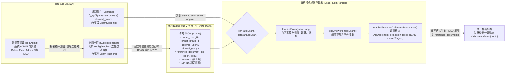
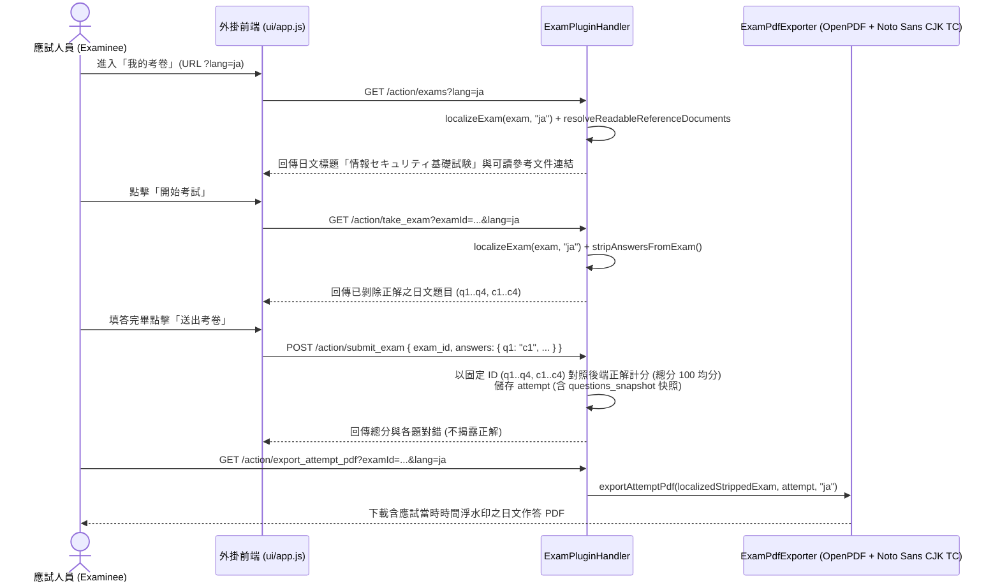

# 線上考試外掛 (`online-exam`) — 完整架構、心路歷程與 AI 開發樣板指南

> **AI 代理必讀**：本文件完整記錄 `online-exam` 外掛從 0 到完整版的架構演進、所有前後端檔案職責、API JSON 契約與關鍵實作細節。修改外掛前請先閱讀上層的 [../AGENTS.md](../AGENTS.md) 與 [../PLUGIN_GUIDE.zh-TW.md](../PLUGIN_GUIDE.zh-TW.md)。

---

## 1. 為什麼這樣設計？(`online-exam` 架構演進心路歷程)

在開發 `online-exam` 示範外掛的過程中，我們解決了以下 6 個真實工程與資安問題，未來 AI 開發新外掛時請直接沿用這些設計模式：

1. **如何隨 Docker / Portable / WAR 整包出貨，又不提前鎖死系統「檔案加密設定」？**
   - 將打包好的 `docs-plugins/dist/plugin-online-exam.zip` 透過 `docs-core/pom.xml` (`maven-resources-plugin`) 複製進 `docs-core` JAR 的 `classpath:plugins/`。
   - **關鍵踩坑**：不能在系統第一次啟動（`AppContext.startUp()`）且管理員尚未選擇是否啟用 AES-256 檔案加密前就呼叫 `FileUtil.createFile(...)`，否則 `FileUtil.createFile` 內部的 `ConfigUtil.ensureFileEncryptLocked()` 會把系統永久鎖死成「不加密」！
   - **最終設計**：在 `PluginSeedService.seedBundledPlugins()` 的 `TransactionUtil.handle(...)` 內檢查 `ConfigUtil.isFileEncryptLocked()`。全新系統啟動時先跳過；等管理員於首次登入彈窗按下確認呼叫 `POST /api/app/file_encrypt`（前端 `Navigation.js` / `SettingsConfig.js` 顯示轉圈處理中 Modal，完成後 `$state.reload()` 自動刷新文件列表）鎖定加密模式的當下，後端 `AppResource.fileEncrypt` 立即呼叫 `PluginSeedService.seedBundledPlugins()`，建立僅 `admin` 可見的 `plugins` 標籤與 `plugins` 文件（內含 16 語系逐行說明與 `plugin-online-exam.zip` 附件）。
2. **如何讓外掛首次啟用 (`onEnabled`) 就自動建好「群組、階層標籤、16 語系教材文件與考卷」且符合資通安全？**
   - 擴充 `PluginHandler.onEnabled(String installerUserId)`，在管理員於 `#/settings/plugins` 首次點擊「啟用」(`POST /api/plugin/online-exam/enable`) 時觸發。
   - 透過 `T_PLUGIN_DATA` 的 `config / demo_seeded = "true"` 確保**冪等（只執行一次）**。
   - 建立無特權群組 `ExamTeachers` 與 `ExamStudents`（`roleId = null`，防止權限提升）、英文階層標籤 `OnlineExamMaterials`（父）→ `SecurityFundamentals`（子）、教材文件 `Security Fundamentals Guide`（內含 16 國語系專屬檔名與內容的 PDF 講義），以及綁定該教材文件的考卷 `SEC-001`。
3. **為什麼程式生成的 PDF 一開始按「眼睛」看不到純文字、也搜尋不到？**
   - 因為 `FileUtil.createFile(...)` 是將 `unencryptedFile` 放進 `FileCreatedAsyncEvent`，在交易 commit 後由背景 `FileProcessingAsyncListener` 非同步讀取以產生縮圖、用 PDFBox 抽取純文字存入 `file.setContent(...)`（供「眼睛」按鈕 `/api/file/{id}/data?size=content` 讀取），並寫入 Lucene 索引。
   - **解決方式**：改用 `AppContext.getInstance().getFileService().createTemporaryFile(pdfFileName)` 建立暫存檔（絕不在 `finally` 提前刪除），並使用 `PdfUtil.BUNDLED_CJK_FONT_FAMILY` (`Noto Sans CJK TC`, `BaseFont.IDENTITY_H`) 渲染 16 國語系 PDF，讓「眼睛」檢視純文字與全文檢索 100% 成功。
4. **如何在不改資料庫 Schema 下讓考卷綁定多份「參考文件」並落實嚴格權限控管？**
   - 在考卷 JSON (`T_PLUGIN_DATA` 的 `exams` 集合) 新增 `reference_document_ids` 字串陣列。
   - **出題端**：透過 `list_reference_documents` 列出老師自己有 `PermType.READ` 權限的文件供勾選；儲存或呼叫 `set_exam_reference_documents` 時再次驗證老師對每份文件具備 `READ` 權限。
   - **應考端（Strict Mode）**：後端在組裝 `exams` 與 `take_exam` 回應時，呼叫 `resolveReadableReferenceDocuments(exam, ctx.getTargetIdList())`，以 `AclDao.checkPermission(docId, PermType.READ, viewerTargetIds)` 過濾——考生必須原本就對該文件有 `READ` 權限才會回傳 `{ id, title }`，否則直接隱藏，絕不洩漏未授權文件標題。點擊後以新分頁開啟 `${APP_ROOT}/#/document/view/${docId}`。
5. **如何讓同一張預設考卷 `SEC-001` 支援 16 國語系又共用成績統計？**
   - 將 16 國語系的考卷標題、4 道題幹與選項翻譯存於 `seed/SEC-001-i18n.json` 並寫入考卷 JSON 的 `"i18n"` 欄位。
   - 題目 ID (`q1..q4`) 與選項 ID (`c1..c4`) 固定不變；當前端帶 `?lang=<currentLang>` 呼叫 `exams`、`take_exam`、`export_blank_pdf`、`export_attempt_pdf` 時，後端透過 `localizeExam(exam, lang)` 動態替換顯示文字，計分與作答紀錄完全互通。

---

## 2. 三層權限模型與嚴格模式參考文件過濾流程圖 (Mermaid)

---

## 3. 多語系考卷動態切換、作答批改與 PDF 匯出序列圖 (Mermaid)

---

## 4. 程式碼與檔案職責完整對照表

| 模組 | 檔案路徑 | 核心實作細節與職責 |
| --- | --- | --- |
| 外掛描述檔 | [plugin.json](plugin.json) | 宣告 `id: "online-exam"`、版號 `1.3.0`、16 國 `nav_label_i18n`，以及隱藏保護標籤 `Online Exam Admin` (`role: "MANAGEMENT"`, `hidden: true`)。 |
| 16 國語系介面字典 | [locale/*.json](locale/) | 涵蓋 16 種語系之 UI 文字與 `error.<Type>` 錯誤碼翻譯。 |
| 預設考卷 GIFT 種子 | [seed/SEC-001.gift](seed/SEC-001.gift) | `SEC-001` 考卷之 4 道題目（單選、複選 `%50%`、是非題）與正解定義。 |
| 預設考卷 16 語系題庫 | [seed/SEC-001-i18n.json](seed/SEC-001-i18n.json) | 收錄 `SEC-001` 於 16 種語系的 `title`、`q1..q4` 題幹與 `q1_choices`、`q2_choices` 選項翻譯。 |
| 前端結構與樣式 | [ui/index.html](ui/index.html)、[ui/style.css](ui/style.css) | 包含「我的考卷」、「作答畫面（含頂部 `#runnerRefDocs` 參考文件列）」、「成績紀錄」、「出題與考卷管理（含建立考卷參考文件多選器）」及「參考文件綁定 Modal (`#refDocsModal`)」。 |
| 前端互動邏輯 | [ui/app.js](ui/app.js) | 實作動態 `ACTION_BASE` 與 `APP_ROOT` 計算、`buildDocumentViewUrl(docId)`、語系載入、漏答檢查與捲動定位、參考文件搜尋勾選與 ACL 設定。 |
| 後端核心處理器 | [ExamPluginHandler.java](../../docs-core/src/main/java/com/sismics/docs/core/util/plugin/exam/ExamPluginHandler.java) | 實作 `onEnabled` 首次啟用自動建置、16 個 `action` 路由、三層權限驗證、`localizeExam` 多語系轉換、`resolveReadableReferenceDocuments` 嚴格權限過濾與 `AuditLog` 稽核。 |
| GIFT 題庫解析器 | [GiftParser.java](../../docs-core/src/main/java/com/sismics/docs/core/util/plugin/exam/GiftParser.java) | 解析 Moodle GIFT 單選 (`=`/`~`)、複選 (`~%weight%`)、是非題 (`{TRUE}`/`{FALSE}`)，內建 512 KB 與 500 題上限防護。 |
| 多語系 PDF 引擎 | [ExamPdfExporter.java](../../docs-core/src/main/java/com/sismics/docs/core/util/plugin/exam/ExamPdfExporter.java) | 使用 OpenPDF + `Noto Sans CJK TC` (`IDENTITY_H`) 產製：(1) 空白考卷 PDF、(2) 含應試時間斜向浮水印之作答 PDF、(3) 橫向成績彙總表 PDF、(4) 16 國語系教材 PDF (`exportTextbookPdf(locale)`)。 |
| 端對端整合測試 | [TestOnlineExamPlugin.java](../../docs-web/src/test/java/com/sismics/docs/rest/TestOnlineExamPlugin.java) | 驗證首次啟用建置、16 份語系 PDF 純文字抽取 (`size=content`)、`SEC-001` 多語系切換、嚴格模式參考文件過濾、三層角色隔離與 PDF 匯出。 |

---

## 5. `ExamPluginHandler` 全部 16 個 Action API 規格一覽

所有 Action 皆透過 `/api/plugin/online-exam/action/{action}` 呼叫：

| Action 名稱 | HTTP 方法 | 權限要求 | 參數 / Body 與功能說明 |
| --- | --- | --- | --- |
| `info` | `GET` | 已登入使用者 | 回傳 `{ is_top_admin, is_teacher, user_id, username, display_name, teacher_groups }`。 |
| `list_teachers` | `GET` | Top Admin | 列出所有啟用中帳號與群組及其是否具備出題老師權限。 |
| `set_teacher` | `POST` | Top Admin | Body: `{ target_type: "USER"\|"GROUP", target_id, allow }`。設定出題老師權限。 |
| `parse_gift` | `POST` | Teacher / Top Admin | Body: `{ gift }`。預覽解析 GIFT 題目格式與題數。 |
| `save_exam` | `POST` | Teacher / Top Admin | Body: `{ id?, title, exam_code, exam_version, total_score, owner_group_id, retake_allowed, enabled, reference_document_ids, gift }`。新增或更新考卷（驗證老師對 `reference_document_ids` 具備 `READ` 權限）。 |
| `toggle_exam` | `POST` | 考卷擁有者 / Top Admin | Body: `{ id, enabled }`。啟用或停用考卷。 |
| `delete_exam` | `POST` | 考卷擁有者 / Top Admin | Body: `{ id, force }`。若已有考生作答且 `force=false` 回傳 `409 ExamHasAttempts`；`force=true` 刪除考卷並保留歷史成績。 |
| `exams` | `GET` | 已登入使用者 | Query: `?lang=<locale>`。回傳當前使用者可管理或可應試的考卷列表（自動套用 `localizeExam` 與嚴格模式過濾之 `reference_documents`）。 |
| `take_exam` | `GET` | 獲授權考生 / 擁有者 | Query: `?examId=<id>&lang=<locale>`。回傳已套用 `localizeExam`、已剝除正解之題目與考生具備 `READ` 權限之 `reference_documents`。 |
| `submit_exam` | `POST` | 獲授權考生 | Body: `{ exam_id, answers }`。後端以 100 分均分批改，儲存含 `questions_snapshot` 之作答紀錄。 |
| `attempts` | `GET` | 已登入使用者 | Top Admin 看全體、老師看自己考卷、學生看自己作答紀錄。 |
| `list_acl_targets` | `GET` | 考卷擁有者 / Top Admin | Query: `?examId=<id>`。列出可授權應試的啟用中帳號與群組。 |
| `set_exam_acl` | `POST` | 考卷擁有者 / Top Admin | Body: `{ exam_id, target_type, target_id, allow }`。授權或移除考生／群組應試權限。 |
| `list_reference_documents` | `GET` | Teacher / Top Admin | Query: `?examId=<id>&q=<keyword>`。列出當前老師具備 `PermType.READ` 權限的系統文件清單與是否已綁定。 |
| `set_exam_reference_documents` | `POST` | 考卷擁有者 / Top Admin | Body: `{ exam_id, document_id, allow }` 或 `{ exam_id, reference_document_ids: [...] }`。驗證老師具備 `READ` 權限後更新考卷綁定的參考文件清單。 |
| `export_blank_pdf` / `export_attempt_pdf` / `export_summary_pdf` | `GET` | 依考卷與成績權限 | Query: `?examId=<id>&lang=<locale>`（彙總表另含 `from`, `to`）。匯出對應語系之 PDF 報表。 |
