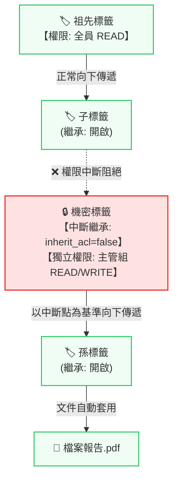

# Spec Delta: 階層式標籤權限與中斷繼承

## Purpose

本規格定義 FormosaBearV-docs 系統中標籤與文件的階層式權限向上回溯繼承、中斷繼承安全邊界隔離、無權限父標籤之樹狀容器導航，以及多重標籤文件存取權限聯集判定機制，提供符合企業組織管理與 Windows 檔案總管模式的安全控管能力。

## ADDED Requirements

### Requirement: 標籤階層式權限向上回溯繼承
系統 MUST 支援當子標籤未中斷繼承時，自動向上繼承所有父標籤及祖先標籤之讀取（READ）與寫入（WRITE）權限，並允許子標籤額外追加專屬授權（權限疊加原則）。

#### Scenario: 子標籤自動繼承父層權限
- **WHEN** 使用者屬於群組 A，且父標籤設定群組 A 具備 READ 權限，而子標籤未設定群組 A 且其繼承開關為開啟
- **THEN** 系統 MUST 允許該使用者讀取該子標籤及其底下所有未中斷繼承之文件

#### Scenario: 寫入權限向下繼承
- **WHEN** 使用者屬於群組 A，且父標籤設定群組 A 具備 WRITE 權限，而子標籤其繼承開關為開啟
- **THEN** 系統 MUST 允許該使用者在該子標籤下建立新文件或新增既有文件關聯

#### Scenario: 標籤權限向上疊加
- **WHEN** 父標籤授權群組 A 具備 READ 權限，子標籤額外授權群組 B 具備 WRITE 權限
- **THEN** 系統 MUST 判定該子標籤同時具備群組 A 的 READ 權限與群組 B 的 WRITE 權限

### Requirement: 標籤中斷權限繼承與狀態轉換
系統 MUST 支援為個別標籤設定中斷繼承開關（inherit_acl）。當中斷繼承屬性為 false 時，系統向上回溯至該標籤即刻終止，上方祖先權限均不得穿透；並在切換中斷與恢復繼承時提供自動化的權限轉換機制。

#### Scenario: 中斷繼承自動複製父層權限
- **WHEN** 管理員取消勾選標籤之「繼承上層標籤權限」
- **THEN** 系統 MUST 自動將其父標籤當前之有效權限複製為本標籤之自訂 ACL，以供管理者直接刪減微調

#### Scenario: 恢復繼承自動清除自訂權限
- **WHEN** 管理員重新勾選標籤之「繼承上層標籤權限」
- **THEN** 系統 MUST 自動清除該標籤之自訂 ACL，使該標籤完全由上層祖先權限所掌控

#### Scenario: 敏感子標籤切斷上層繼承
- **WHEN** 父標籤授權「全員」具備 READ 權限，但機密子標籤之中斷繼承開關為 false，且該子標籤僅授權「主管組」
- **THEN** 非主管組之一般使用者在嘗試存取該機密子標籤或其文件時，系統 MUST 回傳存取拒絕（Forbidden）

### Requirement: 無父層權限時的路徑容器呈現
系統 MUST 支援當使用者對某子標籤具備存取權限，但對其上層父標籤無存取權限時，於標籤樹中將該父標籤作為階層路徑容器呈現。

#### Scenario: 顯示灰色不可點擊之容器節點
- **WHEN** 使用者僅具備獨立子標籤之權限，但無其父標籤之權限
- **THEN** 標籤樹 MUST 顯示該父標籤名稱以維持樹狀階層完整，但該父標籤呈現為灰色不可點擊，且不列出該父標籤底下之文件

### Requirement: 多重標籤文件權限聯集判定
系統 MUST 支援掛載多個標籤之文件，透過各標籤有效權限之聯集進行存取授權判定。只要文件所屬標籤中任一標籤（透過有效祖先鏈）具備所需權限，即授予該文件之存取。

#### Scenario: 具備任一標籤有效權限之使用者可讀取文件
- **WHEN** 某份文件同時被貼上「公開專案」與「內部研究」兩個標籤，使用者僅具備「公開專案」之讀取權限
- **THEN** 系統 MUST 允許該使用者檢視與讀取該文件

#### Scenario: 無任何標籤有效權限之使用者遭阻擋
- **WHEN** 使用者不具備某份文件直接設定之權限，且對該文件貼附之所有標籤（含其祖先鏈）皆無存取權限
- **THEN** 系統在文件列表或檢視該文件時 MUST 予以過濾或阻擋

### Requirement: 標籤管理介面之繼承控制與視覺識別
系統 MUST 於標籤編輯介面分列展示「從上層繼承的權限」與「本標籤專屬權限」，並於標籤樹狀結構中，針對中斷繼承之標籤顯示鎖頭視覺圖示。

#### Scenario: 標籤編輯視窗分列展示繼承權限
- **WHEN** 管理員開啟某繼承標籤之編輯對話框
- **THEN** 介面 MUST 清晰標示「從上層繼承的權限」（註明來源父標籤，無法在此直接刪除）與「本標籤專屬權限」

#### Scenario: 標籤樹顯示隔離鎖頭標記
- **WHEN** 使用者瀏覽標籤管理樹或標籤清單，且某標籤之中斷繼承為 false
- **THEN** 介面在該標籤名稱旁 MUST 顯示鎖頭圖示以清楚標示其為獨立隔離邊界
