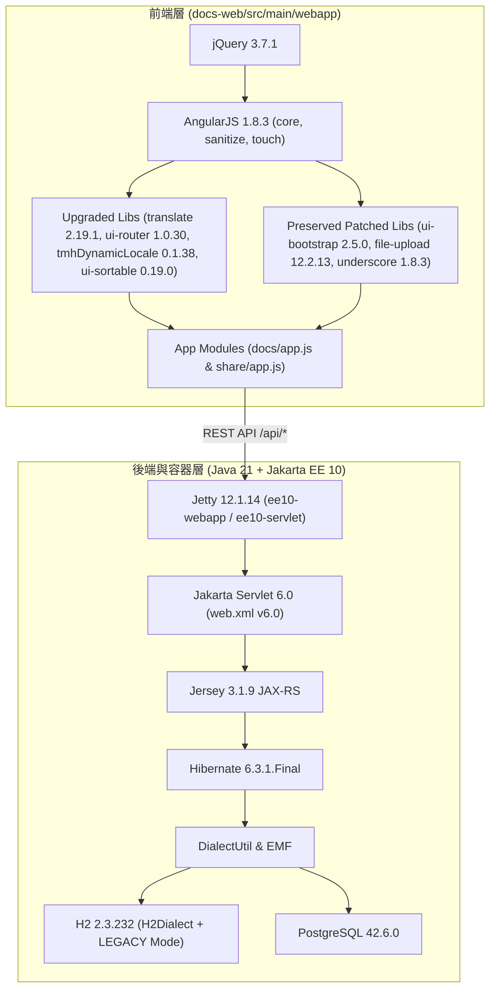
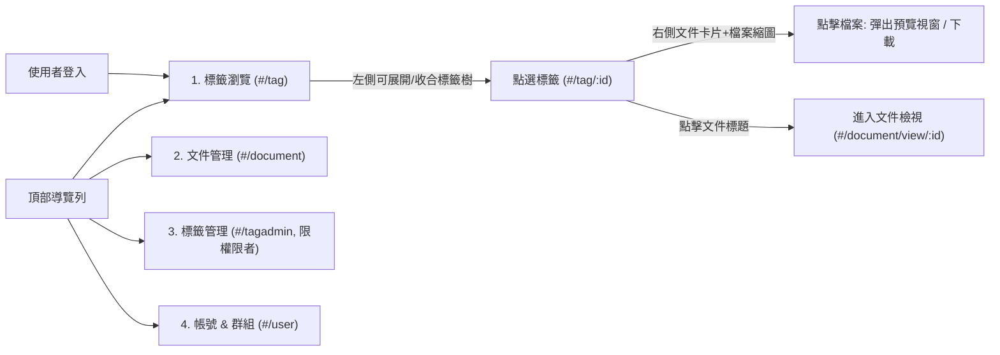

# Design

## Context

本專案 Fork 自 `https://github.com/fmaass/teedy-docs` 1.12，原本已完成初步的 `javax.*` 至 `jakarta.*` (Jakarta EE 9 / Servlet 5.0) 命名空間轉換，但底層仍停留在 Java 11、Jetty 11.0.20、Jersey 3.0.10、H2 1.4.199 以及前端 AngularJS 1.6.6 / jQuery 3.2.1（詳見 `proposal.md`）。

為了讓 `v2.01` 在現代環境中具備長期可維護性與安全性，本次設計涵蓋後端執行期、資料庫方言轉換、容器化部署、前端核心與外掛升級，以及專案文件重整。



## Goals / Non-Goals

**Goals:**
- 將 Maven 編譯目標與容器執行環境全面提升至 **Java 21**。
- 將 Jetty 升級至 **`12.1.14` (`ee10`)**，搭配 **Jakarta Servlet `6.0.0`** 與 **Jersey `3.1.9`**。
- 將 H2 升級至 **`2.3.232`**，並透過 `EMF.java` 與 `DialectUtil.java` 轉換舊版 SQL 腳本，確保不需重寫 32 個歷史 `dbupdate-*.sql` 檔案即可通過所有測試。
- 將前端 AngularJS 升級至 **`1.8.3`**、jQuery 升級至 **`3.7.1`**，並升級無客製 Patch 之第三方外掛，且完全相容於現有 Grunt (`uglify`) ES5 打包管線。
- 將專案版本定為 **`2.01`**，並以英文重寫 `README.md`，去除原專案推廣資訊、標註 Fork 自 `fmaass/teedy-docs` 1.12。

**Non-Goals:**
- 不重寫前端為 Angular 2+ / React / Vue（維持 AngularJS 1.x 架構）。
- 不覆蓋含有 Teedy 專屬客製化程式碼的 `angular.ui-bootstrap.js`（內含自訂 `dialog` 模組與 FontAwesome 圖示）與 `angular.file-upload.js`（內含檔名 `encodeURIComponent` 修正）。
- 不升級 Lucene 8.7.0 至 9.x（避免破壞既有全文檢索索引格式）。

## Decisions

### 1. Jetty 12.1 採用 `ee10` 環境模組而非 `ee9` 或 `ee11`
- **決策**：在 `pom.xml`、`docs-web/pom.xml`、`Dockerfile` 與 `docs.xml` 中採用 `org.eclipse.jetty.ee10`（對應 Jakarta EE 10 / Servlet 6.0），並搭配 Jersey `3.1.9`。
- **原因**：Hibernate `6.3.1.Final` 與 Jersey `3.1.x` 原生針對 Jakarta EE 10 驗證最完整；同時 Jetty 12 的 `org.eclipse.jetty.ee10.webapp.WebAppContext` 與 `jetty-ee10-maven-plugin` 可無縫銜接現有 Filter 與 Servlet 架構。
- **替代方案**：維持 `ee9`（無法升級至 Servlet 6.0 與 Jersey 3.1）或跳至 `ee11`（Jersey 與部分周邊套件對 EE11 的支援尚不如 EE10 穩定）。

### 2. H2 2.3.232 相容性透過 `EMF` 與 `DialectUtil` 集中轉換
- **決策**：
  1. 在 `EMF.java` 與兩處測試 `hibernate.properties` 中，將 `org.hibernate.dialect.HSQLDialect` 改為 `org.hibernate.dialect.H2Dialect`。
  2. 在 H2 JDBC URL 加入 `;IGNORECASE=TRUE;MODE=LEGACY;NON_KEYWORDS=VALUE,USER`（測試記憶體資料庫加入 `;DB_CLOSE_DELAY=-1;IGNORECASE=TRUE;MODE=LEGACY;NON_KEYWORDS=VALUE,USER`）。
  3. 在 `DialectUtil.java` 中新增 `transformToH2(String sql)`，當目標為 H2 時，忽略已被 H2 2.x 移除的 `SET IGNORECASE TRUE` 指令（改由 JDBC URL `IGNORECASE=TRUE` 處理），並將 HSQLDB 風格的 `(cached|memory) table`、`datetime`、`longvarchar`、`bit default 0/1` 轉換為標準語法。
- **原因**：專案內有數十個 `dbupdate-xxx-x.sql` 歷史腳本，透過 `DialectUtil` 動態轉換（與現有 `transformToPostgresql` 相同的設計模式）可保持所有歷史 SQL 檔案原貌並同時相容 H2 2.x 與 PostgreSQL。

### 3. 前端升級直接更新官方模組與外掛，不注入全域 Polyfill
- **決策**：經靜態掃描確認，`src/app/` 完全沒有呼叫 AngularJS 1.7/1.8 移除的 `angular.lowercase` / `angular.uppercase`，僅舊版 `angular.sanitize.js` 與 `angular.touch.js` 有呼叫。因此直接將 `angular.js`、`angular.sanitize.js`、`angular.touch.js` 同步升至 `1.8.3` 即可從源頭消除問題。
- **注意細節**：`src/lib/angular.translate.js` 尾端原本合併了 `angular-translate-loader-static-files`，升級至 `2.19.1` 時必須同樣將 `angular-translate@2.19.1` 與 `angular-translate-loader-static-files@2.19.1` 合併寫入 `src/lib/angular.translate.js`，確保 `$translateProvider.useStaticFilesLoader` 正常運作。

### 4. Java 21 測試環境 (`maven-surefire-plugin`) 防呆配置
- **決策**：將 `maven-surefire-plugin` 升級至 `3.2.5`，並檢查 `apacheds-all` (`2.0.0.AM27`) 等測試套件在 Java 21 下執行時是否需要 `--add-opens` JVM 參數（例如 `java.base/java.lang=ALL-UNNAMED`、`java.base/java.util=ALL-UNNAMED`、`java.base/sun.security.x509=ALL-UNNAMED`），確保所有單元與整合測試可順暢執行。

### 5. 導覽列與「標籤瀏覽 (`#/tag`)」/「標籤管理 (`#/tagadmin`)」職責分離設計
- **決策**：
  1. 將登入後預設首頁（`Main.js`、`Login.js`）改為 `tag.default` (`#/tag`)。
  2. 頂部導覽列依序排列為：**「標籤 (`#/tag`)」**、**「文件管理 (`#/document`)」**、**「標籤管理 (`#/tagadmin`)」**（僅當使用者屬於 `administrators`、`tag_editor` 群組或具備 `ADMIN` 角色時顯示）、**「帳號 & 群組 (`#/user`)」**。
  3. 左側標籤樹實作可展開/收合（Expand / Collapse）機制：預設僅顯示第一層根標籤，提供節點展開/收合箭頭與頂部「全部展開 / 全部收合」按鈕；當透過網址進入子標籤時自動展開其上層父節點。
  4. 在「標籤 (`#/tag/:id`)」瀏覽頁右側，透過後端既有 `GET /api/document/list?search=tag:標籤名&files=true` 取得關聯文件與其內部檔案 (`document.files`)，支援該標籤內的關鍵字篩選、標題/建立時間排序與分頁，並以文件卡片直接展開檔案縮圖與檔名；點擊檔案直接在當前頁面開啟預覽視窗 (`FileModalView`)，點擊文件標題則進入完整文件檢視頁 (`#/document/view/:id`)。



### 6. 標籤節點「子目錄數 + 文件數」雙徽章與檔案儲存設定資料庫化 (`file.encrypt` / `file.delete` / `file.duplicate`)
- **決策**：
  1. **標籤文件數統計**：於 `TagDao.getDocumentCountByTag(String userId)` 透過使用者可見文件 (`PermissionUtil.getTargetIdList`) 與 `T_DOCUMENT_TAG` 關聯計算每個標籤的關聯文件數 `document_count`，並在左側標籤樹與右側子標籤按鈕同時顯示 `<i class="far fa-folder"></i> 子目錄數` 與 `<i class="far fa-file-alt"></i> 文件數`。
  2. **`file.delete` 與 `file.duplicate` 移入資料庫 (`T_CONFIG`)**：將原本寫死在 `config.properties` 的 `file.delete` 與 `file.duplicate` 納入 `ConfigType`，讓管理員可在 **「設置 -> 設定 (`#/settings/config`)」** 網頁介面即時切換，且為了避免切換 `file.duplicate` 導致不加密模式下既有檔案目錄層級 (`2層` vs `3層`) 找不到檔案，`DirectoryUtil.getStorageDirectory(File)` 統一對有 `documentId` 的檔案採用 3 層路徑並向下相容自動偵測舊有 2 層目錄。
  3. **`file.encrypt` 首次初始化一次性認定並永久鎖定 (`FILE_ENCRYPT_LOCKED`)**：當管理員首次登入且系統尚未鎖定 `FILE_ENCRYPT_LOCKED`（且 `T_FILE` 尚無任何已上傳檔案）時，主動彈出初始化對話框供管理員認定「不加密儲存（推薦）」或「啟用 AES-256 加密儲存」；一旦確認鎖定或系統已上傳第一個檔案，即寫入 `FILE_ENCRYPT_LOCKED = true`，後端 API 與前端 UI 同步永久鎖定，防止中途切換造成新舊檔案加密格式混亂。

```mermaid
flowchart TD
    AdminLogin["管理員登入 / 進入 #/settings/config"] --> CheckLock{"FILE_ENCRYPT_LOCKED == true<br/>或 T_FILE 已有檔案?"}
    CheckLock -->|否 (首次初始化)| PromptModal["彈出首次初始化視窗：<br/>請認定檔案加密模式 (file.encrypt)"]
    PromptModal -->|選擇不加密或加密| LockDB["寫入 T_CONFIG:<br/>FILE_ENCRYPT + FILE_ENCRYPT_LOCKED=true"]
    CheckLock -->|是| LockedState["顯示「已永久鎖定（不可變更）」徽章"]
    LockDB --> LockedState
    AdminConfig["設置 -> 設定 (#/settings/config)"] --> ToggleDelete["動態切換 file.delete<br/>(永久刪除 vs 移至 delete/storage)"]
    AdminConfig --> ToggleDuplicate["動態切換 file.duplicate<br/>(允許 vs 禁止同名檔案)"]
```

## Risks / Trade-offs

- **[Risk] H2 1.4 既有本地測試資料庫檔案無法直接被 H2 2.3 讀取** → **Mitigation**：H2 官方在 1.4 升 2.x 時變更了底層儲存格式；由於生產環境使用 PostgreSQL，而 H2 僅用於單元測試與開發環境，開發環境若已有舊版 H2 檔案可重新初始化，並在文件中明確說明。
- **[Risk] H2 2.x 對保留字（如 `VALUE`、`USER`）與資料型別檢查更嚴格** → **Mitigation**：於 JDBC URL 啟用 `MODE=LEGACY;NON_KEYWORDS=VALUE,USER` 並搭配 `DialectUtil` 轉換，透過完整執行 `docs-core` 與 `docs-web` 測試套件驗證所有 DAO 查詢。
- **[Risk] `angular.translate.js` 單檔合併遺漏 Loader** → **Mitigation**：升級 `angular.translate.js` 時明確合併 `angular-translate` 與 `angular-translate-loader-static-files` 2.19.1 兩個 UMD 模組，並檢查 `$translateStaticFilesLoader` 註冊。
