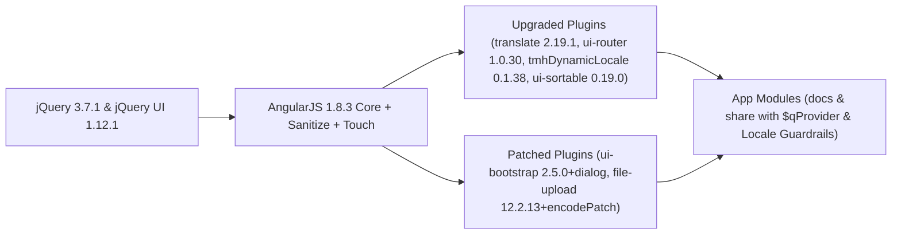

# Spec Delta

## Purpose

定義 Teedy Docs v2.01 前端應用程式（主應用 `docs` 與分享應用 `share`）在升級至 AngularJS 1.8.3、jQuery 3.7.1 及新版第三方外掛時的運行、打包與防呆規範。

## ADDED Requirements

### Requirement: AngularJS 1.8.3 核心與官方附屬模組一致性
前端主應用與分享應用 SHALL 載入版本一致的 AngularJS 1.8.3 核心、HTML 清理 (`ngSanitize`) 與觸控 (`ngTouch`) 模組，不得呼叫任何已在 1.7/1.8 移除的舊版全域 API。

#### Scenario: 啟動前端頁面與渲染富文本內容
- **WHEN** 使用者瀏覽主應用 (`index.html`) 或分享頁面 (`share.html`) 並觸發 `ng-bind-html` 渲染
- **THEN** 瀏覽器主控台 MUST 不出現 `angular.lowercase is not a function` 或模組版本不一致錯誤

### Requirement: 第三方外掛升級與客製化功能保留
前端外掛升級 SHALL 保留專案既有客製化功能（包含靜態語系檔載器 `$translateStaticFilesLoader`、自訂 `$dialog` 服務與 FontAwesome 圖示、以及檔名 `encodeURIComponent` 編碼），並相容於 Grunt ES5 打包壓縮流程。

#### Scenario: 多語系載入與正式環境 Grunt 打包
- **WHEN** 前端載入 `locale/*.json` 語系檔或執行 `grunt` 進行壓縮打包
- **THEN** `$translateStaticFilesLoader` MUST 正常載入語系資源，且 `uglify` 任務 MUST 成功產出 `docs.min.js` 與 `share.min.js`

### Requirement: 分享應用未捕獲 Promise 與語系退回防呆
分享應用 (`share`) SHALL 與主應用一致配置未處理 Promise Rejection 靜默保護與預設語系退回 (Fallback) 機制，避免因無效瀏覽器語系或取消請求導致頁面中斷。

#### Scenario: 瀏覽器回傳未知語系或請求被拒絕時開啟分享頁面
- **WHEN** 使用者在未設定 `localStorage.overrideLang` 且瀏覽器語系無法解析的環境開啟 `share.html`
- **THEN** 系統 MUST 自動退回使用預設英文 (`en`) 語系，且不會因未處理的 Promise Rejection 拋出主控台例外
