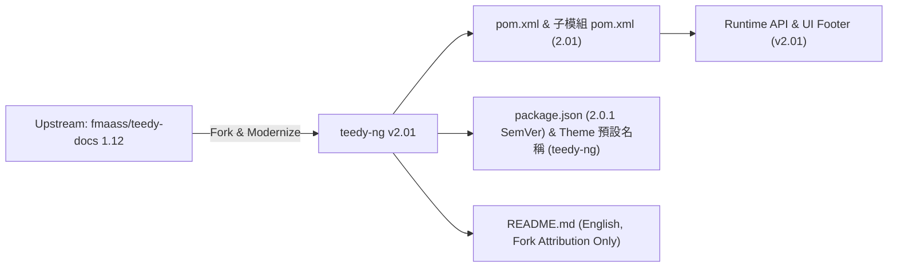

# Spec Delta

## Purpose

定義 `teedy-ng` 自 `fmaass/teedy-docs` 1.12 分支後的全新系統名稱 (`teedy-ng`)、版本號起點 (`2.01`) 與專案主文件 (`README.md`) 規範，確保版本資訊一致且文件完全獨立於原上游專案之品牌推廣。

## ADDED Requirements

### Requirement: 專案全局版本號統一為 2.01
系統所有 Maven 建置配置檔（父子 POM）及應用程式執行期回傳版本號 SHALL 統一設定為 `2.01`（前端 `package.json` 則配合 npm / apidoc SemVer 規範設定為 `2.0.1`）。

#### Scenario: 查詢系統狀態 API 或檢視前端頁尾版本
- **WHEN** 客戶端呼叫 `/api/app` 端點或檢視頁面下方頁尾版本資訊
- **THEN** 系統回傳之 `current_version` 與畫面顯示版本號 MUST 為 `2.01`

### Requirement: README.md 英文改寫與去除原專案推廣資訊
專案根目錄之 `README.md` SHALL 以英文撰寫，明確聲明本專案 Fork 自 `https://github.com/fmaass/teedy-docs` 1.12 且版本從 `2.01` 開始，並移除所有原專案 (`sismics` / `teedy.io`) 之圖示、展示站台、贊助連結與舊版映像檔名稱。

#### Scenario: 檢視專案根目錄 README.md
- **WHEN** 開發者或使用者閱讀 `README.md`
- **THEN** 文件 MUST 包含 Fork 自 `https://github.com/fmaass/teedy-docs` 1.12 之聲明、Java 21 與 Jetty 12.1 (EE10) 的新版建置說明，且不包含任何 `sismics` 或 `teedy.io` 外部連結
