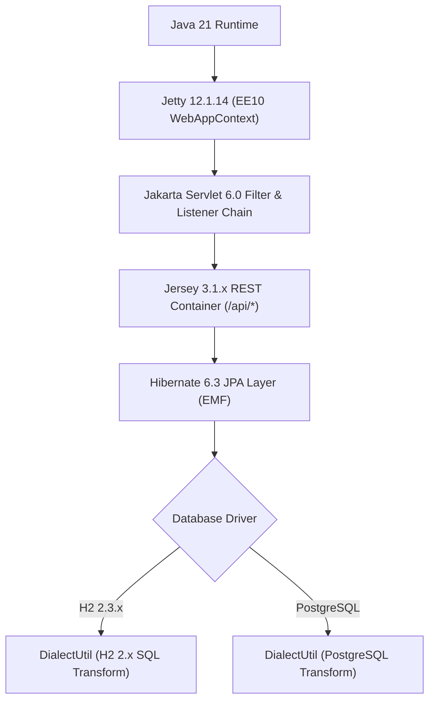

# Spec Delta

## Purpose

定義 Teedy Docs v2.01 的後端執行環境、Web 容器（Jakarta EE 10 / Servlet 6.0）、REST 服務框架、嵌入式資料庫方言轉換與容器化部署規範，確保系統在現代 Java LTS 環境中穩定編譯、測試與運行。

## ADDED Requirements

### Requirement: Java 21 編譯與測試執行環境
系統 SHALL 使用 Java 21 作為編譯來源與目標版本，並能在 Java 21 模組強封裝環境下完整通過單元測試與整合測試。

#### Scenario: Maven 專案於 Java 21 環境建置與測試
- **WHEN** 開發者或 CI 執行 Maven 編譯與測試流程
- **THEN** 所有子模組 (`docs-core`, `docs-web-common`, `docs-web`) MUST 以 Java 21 字節碼標準完成編譯且測試執行不發生模組封裝反射拒絕錯誤

### Requirement: Jakarta EE 10 與 Servlet 6.0 容器相容性
系統 Web 模組 SHALL 遵循 Jakarta Servlet 6.0 規範，並透過支援 EE10 環境的應用伺服器與 JAX-RS 3.1 容器提供 `/api/*` REST 服務。

#### Scenario: 啟動開發伺服器或部署 WAR 套件
- **WHEN** 系統於 EE10 Web 容器啟動並載入 `web.xml` 與 `web-override.xml`
- **THEN** 容器 MUST 以 Servlet 6.0 規範解析描述檔，並正常初始化 CORS、安全性 Filter 與 REST 端點

### Requirement: H2 2.x 資料庫增量腳本相容與方言轉換
當系統使用內嵌或記憶體 H2 2.x 資料庫時，資料庫初始化與升級機制 SHALL 自動將舊版 HSQLDB/H2 1.4 語法轉換為 H2 2.x 相容語法，且忽略不支援的舊版指令。

#### Scenario: 於 H2 2.x 環境執行資料庫初始化與增量更新腳本
- **WHEN** 系統在空白 H2 2.x 資料庫啟動並依序執行 `dbupdate-*.sql` 腳本
- **THEN** 系統 MUST 自動轉換 `cached/memory table`、`longvarchar` 與 `bit default 0/1` 等語法並完成所有版本更新且無 SQL 例外

### Requirement: 容器化部署環境一致性
系統提供的容器建置檔與部署描述檔 SHALL 採用 OpenJDK 21 與 EE10 WebAppContext 模組配置。

#### Scenario: 建置並啟動 Docker 容器映像檔
- **WHEN** 管理員依據 `Dockerfile` 與 `docs.xml` 建置並啟動容器
- **THEN** 容器內部 MUST 使用 Java 21 並啟用 `ee10-webapp` 與 `ee10-deploy` 模組成功掛載 `docs.war`
